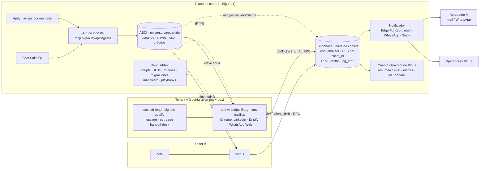

# Arquitectura objetivo · SDR BOT multitenant

Diseño de la solución a partir del documento v1.1 y de la revisión en `01-revision-diseno-v1.1.md`. Describe qué hay que construir y operar en el backend y la infraestructura, cómo se aísla cada cliente, y qué contratos fijan la frontera entre el plano de control de Biguá y el plano de ejecución de cada tenant.

No hay código acá. Lo que se nombra como RPC, tool o script es contrato, no implementación.

## 1. Principios

1. **Un plano de control, N planos de ejecución.** Biguá opera lo compartido (ASCI, ingesta, base de control, plantilla, tablero, alertas). Cada cliente tiene su cuenta de Grok Bot, su box y sus sesiones. Nada de un tenant es visible desde otro.
2. **La base hace cumplir las reglas.** Cupos, no contactar, deduplicación, follow-ups y aprobaciones se validan en Postgres. Un bot nunca "se acuerda" de una regla: la pregunta.
3. **Todo lo que no es sesión de navegador vive en el repo.** Scripts, prompts de skills, definición de routines, migraciones, playbooks y el esquema del manifiesto. Un tenant corre un tag.
4. **Una identidad por tenant, por sistema.** Un usuario de ASCI, un usuario de Supabase Auth, una cuenta de Grok Bot, un box. Todos nombrados con el `slug` del tenant.
5. **Humano donde hay riesgo.** WhatsApp, leads calientes y tibios, textos base, consumo de créditos cerca del tope. El resto es programático o IA con esquema fijo.
6. **Idempotente por defecto.** Toda routine abre una corrida por `run_key`; todo envío se registra por `external_ref`; toda aprobación tiene un token y una decisión cruda guardada.

## 2. Vista general

## 3. Plano de control: componentes

| Componente | Qué hace | Tecnología | Estado |
|---|---|---|---|
| **ASCI + MCP** | Universo compartido de cuentas, señales y decisores; Apollo por detrás; usuarios, claves, medidor de uso y créditos | Existente en `mcp.bigua.lat` | Existe. Falta: rol `sdr_bot`, presupuesto por usuario, `mi_uso` (opcional) |
| **Ingesta** | Apify (avisos) y CSV (SalesQL) → ASCI | Existente, rol `ingesta` | Existe. Falta: jobs de Apify parametrizados por mercado y vertical de cada tenant |
| **Base de control** | Estado operativo por tenant: cuentas, contactos, secuencias, envíos, respuestas, aprobaciones, tareas, corridas, alertas | Supabase (Postgres 15+, Auth, pg_cron, Edge Functions, Storage) | A construir (sección 7 del documento + deltas de la revisión §5) |
| **Notificador** | Convierte filas de `notifications` y `alerts` en mails, WhatsApp o Slack; registra `external_ref` | Edge Function disparada por pg_cron cada minuto o por `pg_net` desde triggers | A construir |
| **Repo `sdrbot`** | Fuente única de scripts, skills (prompts como archivos), definición de routines, migraciones, esquema del manifiesto, playbooks, tests de aislamiento | Git + CI (lint, tests de RLS con pgTAP, corrida en seco contra una base efímera) | Este repo |
| **Plantilla SDR BOT** | Los seis bots y sus routines, exportables a una cuenta nueva | Grok Bot (`export-bot-template`) | A construir; se mantiene **fina**: cada bot carga su skill desde el repo clonado en el box |
| **Cuenta Grok Bot de Biguá** | Resumen consolidado 19:00, alertas críticas, mantenimiento con MCP admin de Supabase, sincronización de uso de ASCI | Grok Bot | A construir |
| **Tablero** | Vistas `v_*` consultadas por operadores; fase 2: app web mínima para Biguá y para aprobaciones del cliente | Fase 1: vistas + resumen por mail. Fase 2: app en Vercel sobre Supabase con magic link | Fase 1 / Fase 2 |
| **Secretos** | Runtime: los secretos de la cuenta de Grok Bot de cada tenant. Plano de control: Supabase Vault del proyecto `sdrbot` (ASCI ya lo usa para las claves del MCP en `radar.usuario_mcp`) | Grok Bot secrets + Supabase Vault. Sin gestor de contraseñas externo | Decidido (ver §5.2) |

### 3.1 Supabase: decisiones de infraestructura

- **Un proyecto propio, `sdrbot`, separado del proyecto `locasci` de ASCI**, en la misma organización y región (sa-east-1), con el esquema `sdr`, RLS en todas las tablas y vistas `security_invoker`. Un solo proyecto para todos los tenants; separar a un proyecto por tenant sólo por exigencia contractual.
  - Por qué no el mismo proyecto que ASCI: el corpus de ASCI pesa más de 3 GB y tiene refrescos y cargas que ya dejaron el pooler trabado 25 minutos y la base colgada 6 horas (documentado en `locasci/docs/00-mapa.md`). La ruta de envío del SDR no puede depender de la salud del corpus. Además son datos de distinta clase: ASCI es un universo compartido sin datos de cliente; `sdr` guarda datos personales por cliente con retención y borrado por tenant. Y `consultar` ejecuta SQL libre del admin sobre esa base; aunque el rol `locasci_consulta` sólo ve `core`, conviene que el esquema con datos de clientes no esté en el mismo servidor.
  - Qué se comparte igual: el eje de tenencia. `sdr.clients.asci_cliente_id` guarda el `cliente_id` de `ops.cliente` de ASCI, así `uso` de ASCI y la base de control hablan del mismo tenant. En fase 2, el servidor MCP de ASCI abre un segundo pool hacia `sdrbot` y expone las RPC como tools `sdr.*` autenticadas con la clave de ASCI del tenant.
  - Alternativa si se quiere minimizar operación en fase 1: esquema `sdr` dentro de `locasci`, con un rol de base propio sin acceso a `core` ni `ops`. Es reversible mientras todo pase por RPC, pero hereda los riesgos de arriba.
- **Auth:** alta pública desactivada. Un usuario por tenant (`sdr.<slug>@bigua.lat`) creado por API admin con `app_metadata.client_id`. Los operadores de Biguá entran con su mail y ven lo que dice `client_members`. Los aprobadores de los clientes **no** necesitan usuario en fase 1 (aprueban por mail); en fase 2 entran por magic link.
- **pg_cron** para lo determinístico; cada job itera tenants activos y calcula "hoy" con `clients.timezone`.
- **pg_net / Edge Functions** para salir hacia el notificador. Nunca llamadas a ASCI ni a LLM desde la base.
- **Storage** para exportaciones de offboarding y adjuntos de evidencia.
- **Backups** diarios con PITR; retención según `client_config.legal.retention_months`; purga semanal.
- **Entornos:** `dev` (rama de Supabase por PR), `staging` (tenant canario), `prod`. Las migraciones salen del repo y se aplican por CI, nunca por el MCP admin.

### 3.2 Tests de aislamiento como parte del contrato

En CI, para cada tabla y vista de `sdr`: un usuario con `client_id = A` no lee, inserta, actualiza ni borra filas de `B`; una RPC llamada con un `client_id` ajeno falla; `do_not_contact` global es legible por todos y escribible sólo por `service_role`. Sin esto no se despliega una migración.

## 4. Plano de ejecución: el kit de tenant

Lo que se instancia por cliente, siempre igual.

| Pieza | Contenido | Dueño | Provisión |
|---|---|---|---|
| **Cuenta de Grok Bot** | Seis bots desde la plantilla, routines con los horarios del manifiesto, secretos (`SUPABASE_URL`, `SUPABASE_ANON_KEY`, `SDR_BOT_EMAIL`, `SDR_BOT_PASSWORD`, `ASCI_KEY`, `TENANT_SLUG`, `SCRIPTS_TAG`), el cliente como miembro aprobador | Biguá durante el contrato | Biguá |
| **Box** | La computadora virtual que Grok Bot da a cada cuenta: clon del repo en el tag; `.env` de casillas con permisos de archivo restringidos; perfil de Chrome con WhatsApp Web, LinkedIn/Sales Nav y Dripify; Python para los scripts. No hay VPS aparte ni equipo del cliente | Viene con la cuenta de Grok Bot del tenant | Biguá, con el instalador del repo |
| **Infra de mail** | Dominio alternativo, SPF/DKIM/DMARC (`p=quarantine` mínimo), 3 a 5 casillas, warm-up por escalones | Cliente (o Biguá como servicio gestionado) | Según `channels.email.dns_owner` |
| **Seat de LinkedIn** | Perfil del vendedor + Sales Navigator + Dripify, login y 2FA hechos por el dueño en el box | Cliente | Cliente |
| **Línea de WhatsApp** | Número dedicado, teléfono físico disponible para el QR, persona que aprueba tandas | Cliente | Cliente |
| **CRM** | HubSpot (adaptador) o ninguno | Cliente | Cliente |

### 4.1 El box es la computadora de Grok Bot

El box es la máquina virtual que Grok Bot asigna a cada cuenta, la misma que el documento v1.1 llama "la computadora del Grok Bot del cliente". Una cuenta por tenant implica un box por tenant, y eso es lo que aísla sesiones de navegador y archivos. No hay VPS de Biguá ni equipo del cliente: la mención a un VPS en la primera versión de este diseño era un respaldo por si el box no sostenía sesiones persistentes, y se descarta.

Lo que hay que **verificar con Grok Bot** antes de la fase 1, porque el diseño lo asume:

| Supuesto | Si no se cumple |
|---|---|
| Las sesiones de Chrome (WhatsApp Web, LinkedIn, Dripify) sobreviven a reinicios del box | El QR y los logins se repiten cada día; el canal WhatsApp deja de ser viable |
| Los archivos persisten (clon del repo, `.env`, perfil de Chrome) | Los scripts tienen que reinstalarse en cada corrida desde un secreto |
| Una routine puede ejecutar un script de Python con acceso saliente a SMTP (587) e IMAP (993), a `mcp.bigua.lat` y a Supabase | Los envíos de mail pasan al conector de Gmail de Grok Bot y los scripts se achican |
| El dueño de cada sesión puede entrar al escritorio del box (RDP, VNC o equivalente) para el QR y el 2FA | Los logins los hace Biguá con el cliente al lado, por pantalla compartida |
| El reloj del box puede fijarse en la zona del tenant, o el script convierte | Horarios de envío corridos |
| El box puede correr una routine corta cada 5 a 15 minutos | El heartbeat se reemplaza por detección de corridas ausentes (abajo) |

Se lo trata como un servicio igual:

- **Heartbeat** por routine corta (cada 5 a 15 minutos si Grok Bot lo permite; si no, al inicio de cada routine) a `boxes`: tag de scripts, estado de cada sesión (ok, vencida, desconocida) y si Chrome está adelante.
- **Chequeo de sesiones 07:30** lee `boxes` y el vencimiento de la clave de ASCI; si algo falla, frena el canal (`channel_seats.status = paused` o `mailboxes.status = paused`), levanta `connector_down` y crea la tarea `login_2fa` para el dueño de la sesión.
- **Corrida ausente**: pg_cron compara `schedule` del tenant con `run_log`; una routine que no abrió corrida 30 minutos después de su hora es `run_stale` crítico a Biguá. Esto no depende del box.
- **Actualización de scripts** = `git fetch && git checkout <tag>` ejecutado por una routine de mantenimiento, con el tag leído del secreto `SCRIPTS_TAG`. Cambiar la versión de un tenant es cambiar un secreto.
- **Sin credenciales de Biguá ni de otros tenants** en el box. Lo único de Biguá que hay en un box es el clon del repo, que es público para el tenant.

## 5. Identidad, tenancy y secretos

Quién tiene qué, por tenant `A`:

| Sistema | Identidad del tenant | Alcance | Dónde vive el secreto | Rotación |
|---|---|---|---|---|
| ASCI | Usuario `sdr.A@bigua.lat`, rol `sdr_bot` (hasta que exista: `operador`), `cliente = A`, clave nombrada `SDR BOT · A · box` | Lectura del universo, reveal con presupuesto, sin curación ni ingesta ni SQL | Secreto `ASCI_KEY` en Grok Bot de A; el `clave_id` (no la clave) en Supabase Vault | Anual o ante incidente: `crear_clave` nueva → actualizar secreto → `revocar_clave` vieja. Sin corte |
| Supabase | Usuario Auth `sdr.A@bigua.lat` con `app_metadata.client_id = A` | Sólo filas con `client_id = A`, vía RLS; sólo RPC | `SDR_BOT_EMAIL` y `SDR_BOT_PASSWORD` en Grok Bot de A | Semestral por API admin |
| Grok Bot | Cuenta `A`: propiedad de Biguá durante el contrato (modelo operado) o del cliente (modelo fábrica), ver §5.1 | Bots, routines, box, secretos de A | n/a | Según producto |
| Casillas | `.env` por casilla en el box | SMTP/IMAP de ese dominio | Box de A, permisos 600, cargado por el cliente | Cuando el cliente lo decida |
| LinkedIn / Dripify / WhatsApp | Sesiones de navegador | Perfil de Chrome del box de A | Box de A; el agente nunca ve contraseñas | La hace el dueño |
| CRM | Token privado de HubSpot con scopes mínimos | Portal del cliente | Secreto `HUBSPOT_TOKEN` en Grok Bot de A | Según el cliente |

Reglas:

- `service_role` de Supabase, la clave admin de ASCI y el MCP admin de Supabase existen **sólo** en la cuenta de Grok Bot de Biguá y en CI.
- Ningún secreto en el repo, en prompts, en Sheets ni en mails. Los secretos se cargan como secretos de Grok Bot; lo que Biguá necesita conservar va a Supabase Vault (§5.2).
- Cada tenant tiene su propio usuario en ASCI aunque el cliente ya tenga usuarios humanos ahí (como Tacco hoy). El uso del bot no se mezcla con el uso de una persona.

### 5.1 Dos modelos de propiedad de la cuenta de Grok Bot

El diseño soporta los dos porque todo el estado del servicio está en el plano de control y todos los secretos del tenant están en su cuenta de Grok Bot. Cambiar de modelo es cambiar quién administra la cuenta, no rehacer nada.

| | **Operado por Biguá** (default) | **Fábrica de implementación** |
|---|---|---|
| Dueño de la cuenta y del box | Biguá, durante el contrato | El cliente desde el alta (o por transferencia después) |
| Quién paga Grok Bot | Biguá, dentro del servicio | El cliente |
| Rol de Biguá en la cuenta | Administrador | Miembro con permiso de administración mientras dure el soporte; se retira a la baja |
| Rol del cliente en la cuenta | Miembro aprobador | Dueño; aprueba y además opera |
| Quién carga los secretos | Biguá (los de Biguá) y el cliente (casillas) | Igual: la clave de ASCI y la credencial de Supabase las emite Biguá y las carga como secretos; las casillas, el cliente |
| Lo que sigue siendo de Biguá | ASCI, la base de control, la plantilla, el repo y los playbooks | Lo mismo. La clave de ASCI y la credencial de Supabase son revocables por Biguá: es el corte de servicio |
| Releases de la plantilla | Biguá cambia `SCRIPTS_TAG` y corre mantenimiento | Biguá propone el tag; el cliente o Biguá con su permiso lo aplica |
| Baja | Biguá exporta, revoca y cierra o entrega la cuenta | Biguá exporta y revoca; la cuenta queda del cliente con los bots inertes |
| Estándar | La plantilla, el manifiesto y el runbook son los mismos | Igual. Lo único que agrega es el checklist de transferencia |

Condiciones para que el modelo fábrica funcione sin romper el aislamiento: la cuenta de Biguá nunca comparte box ni secretos con la del cliente; el cliente no recibe `service_role`, clave admin de ASCI ni acceso a la base de control fuera de su `client_id`; y el soporte de Biguá se da como miembro de la cuenta del cliente, con el permiso mínimo que Grok Bot permita (punto a confirmar con producto, igual que el scope de conectores).

### 5.2 Dónde viven los secretos

No hace falta un gestor de contraseñas externo. Dos lugares, con un rol cada uno:

| Lugar | Qué guarda | Por qué ahí |
|---|---|---|
| **Secretos de la cuenta de Grok Bot del tenant** | `ASCI_KEY`, `SDR_BOT_EMAIL`, `SDR_BOT_PASSWORD`, `SUPABASE_URL`, `SUPABASE_ANON_KEY`, `TENANT_SLUG`, `SCRIPTS_TAG`, token de CRM. Las credenciales SMTP/IMAP van como `.env` en el box, cargadas por el cliente | Es lo que los scripts leen. Viaja con la cuenta si se transfiere (modelo fábrica). Biguá no guarda copia de las casillas del cliente: no son suyas |
| **Supabase Vault del proyecto `sdrbot`** | Por tenant: la contraseña del usuario Auth del bot (para reemitir sin resetear) y el `clave_id` de ASCI (no la clave). De Biguá: clave admin de ASCI para la sincronización de uso, `service_role` para CI y offboarding | ASCI ya usa Vault para las claves del MCP de Radar; es el mismo mecanismo y el mismo equipo. Acceso sólo desde funciones `security definer` del esquema `sdr` y desde CI |

Qué no se guarda en ningún lado de Biguá: contraseñas de LinkedIn, Dripify, WhatsApp ni de las casillas. Las sesiones viven en el box y las credenciales las carga el cliente. La clave de ASCI se muestra una sola vez al crearla y se carga directo como secreto; si se pierde, se rota.

Entrega de la clave de ASCI al tenant: Biguá la crea y la carga en la cuenta de Grok Bot del tenant en el mismo paso del alta. En el modelo fábrica, si la cuenta ya es del cliente, Biguá la carga como miembro administrador o la entrega por un enlace de un solo uso, nunca por mail ni chat.

## 6. Integración con ASCI

### 6.1 Rol `sdr_bot` (pedido a ASCI)

Especificación completa en `04-rol-sdr-bot-asci.md`. Resumen: una fila en `ops.rol` con `requiere_cliente = true` y `ve_todas_las_cuentas = true`; 14 tools en `ops.permiso` (lectura, prospección, decisores, reveal, `personas_por_mail` con cupo); una fila en `ops.presupuesto_apollo` (100 búsquedas, 40 créditos, 0 teléfonos por día). Sin curación, ingesta, administración ni SQL.

El presupuesto de ASCI ya se aplica **por usuario y por día** (`ops.apollo_presupuesto()` cuenta `ops.apollo_llamada` del usuario en contexto), así que con un usuario por tenant el tope del rol ya es un tope por tenant. Cada tool de Apollo devuelve `presupuesto` en su respuesta; el script lee `puede_gastar` y, si es `false`, registra el motivo y sigue. El tope mensual y el override por tenant son el cambio chico propuesto en 04 §4.2; hasta que exista, el tope mensual lo hace cumplir la base de control (`credits` del manifiesto).

Mientras el rol no exista: `operador` con clave nombrada y el tope diario y mensual espejados en Supabase, que el script valida **antes** de llamar a reveal. Es una barrera de software, no de ASCI; aceptable para los dos primeros tenants.

### 6.2 Política de reveal programático

ASCI exige que "el usuario" elija a quién revelar. En el SDR el usuario es el `client_config` del tenant. La decisión se registra antes de gastar:

1. `tomadores_de_decision` (caché, gratis) y, si no alcanza, `buscar_contactos` con `rol`, `titulos` y `seniority` del ICP (Apollo, gratis, cuota diaria del endpoint).
2. Filtro programático (`decision_maker_rules`) → descarta por título.
3. IA de calificación → JSON (`buying_role`, `is_decision_maker`, `score`, `rationale`) → `set_qualification`.
4. Sólo con `is_decision_maker = true`, `score ≥ umbral`, `max_contacts_per_account` no alcanzado, `check_dnc` limpio y presupuesto disponible: `revelar_lote` (hasta 25, consulta caché primero).
5. `upsert_contact` con `email_status` (`verified` / `extrapolated` → el tenant decide si acepta extrapolados; BairesQA no), `revealed_at`, y teléfono sólo si `llega_a_la_persona = true`.

Cada reveal queda atado a la calificación que lo justificó. Es lo que permite auditar un gasto meses después.

### 6.3 Sincronización de uso

Corre en la **cuenta de Biguá** (clave admin), no en los tenants: una vez por día, `uso(desde = primer día del mes)` → por cada `cliente` del resultado, `sync_asci_usage(client_id, day, raw jsonb)` con `service_role`. El umbral de aviso (`credits.warn_at_percent`) genera `credit_threshold` y la tarea `approve_credits` al aprobador de créditos del tenant. El resumen de las 18:50 del tenant lee `asci_usage`, no ASCI.

Si ASCI agrega `mi_uso` (04 §6.2), la routine puede moverse al tenant sin cambiar la tabla. Para el vencimiento de la clave hace falta `mi_clave` (04 §6.1); hasta entonces, `clients.asci_key_expires_at` se carga en el alta y lo lee el chequeo de las 07:30.

### 6.4 Playbook de señales estándar

El `signal_playbook` del manifiesto es una lista de consultas con fuente, parámetros, frecuencia y disparador. El bot `signals` no inventa consultas: ejecuta el playbook. Fuentes:

| Fuente | Tool / job | Qué detecta | Frecuencia típica | Dispara |
|---|---|---|---|---|
| Avisos (Apify → ASCI) | `prospectar` con `ordenar_por: avisos` o `novedades` (avisos publicados) | Necesidad abierta en la vertical del tenant | Semanal | Secuencia de aviso, tier 1 |
| Stack / capacidad | `prospectar` por `categorias`, `fabricante`, `ciclos_vida` | Cuentas con la tecnología que el tenant atiende | Semanal | Secuencia de stack, tier 2 |
| Decisor nuevo | `rotacion` con `roles` del ICP sobre cuentas ya trabajadas | Quien llega todavía no eligió proveedor | Diaria | Secuencia "nuevo decisor", prioridad alta |
| Novedades de cuenta | `novedades` sobre cuentas en secuencia o engaged | Contexto para seguimientos y tesis | Semanal | Tarea de revisión o tesis de follow-up |
| Avisos fuera de LATAM | Apify directo (EE.UU., España) → ingesta | Lo que ASCI no cubre | Semanal | Secuencia de aviso |

Cada señal se guarda en `signals` con `asci_signal_id` o un id derivado (fuente + cuenta + fecha), con `evidence_url` y `summary`. La tesis del mensaje (`messages.thesis`) referencia la señal. Es lo que diferencia un mensaje por señal de un mail frío.

## 7. Flujos y contratos

### 7.1 Routine → script → RPC

Una routine de Grok Bot ejecuta un script del repo en el box. El contrato del script:

- Lee `TENANT_SLUG`, `SCRIPTS_TAG` y los secretos del entorno. Nunca argumentos con credenciales.
- Abre `start_run(client, routine, run_key)`; si la corrida ya existe y no está en error, sale con código 0 y el log "ya corrida".
- Llama RPCs tipadas. Un rechazo de la base (cap, DNC, follow-up, aprobación) se registra como motivo en el log de la corrida y **no se reintenta por otro camino**.
- Toda llamada a IA pasa por un módulo que valida el JSON contra un esquema del repo (`schemas/*.json`). Si no valida: `run_log.error`, tarea `review_reply` al operador de Biguá, y sigue con el próximo ítem.
- Cierra con `finish_run(status, items_in, items_out, credits, error)`. Una corrida que no cierra en 2 horas es `run_stale` (pg_cron).
- Salida en JSON por stdout para que el bot pueda redactar el resumen sin leer la base.

### 7.2 Aprobaciones (canal de control endurecido)

Una sola tabla `approvals` para tandas de WhatsApp, respuestas a leads, secuencias y créditos. Flujo por mail (fase 1):

1. `request_approval(kind, ref_id, approver)` crea la fila con un `token` corto y único y encola la notificación. El asunto lleva `[SDR A-7f3k]` (slug y token).
2. El aprobador responde en el hilo: `OK`, `OK 1,3`, `NO`, `N: texto`, `YO`.
3. El monitoreo de casillas acepta la respuesta sólo si: el `From` es la dirección exacta del aprobador registrado, SPF o DKIM alineados con su dominio, y el asunto trae el token de una aprobación `pending`. Si no, la ignora y levanta `approval_rejected_sender` (info).
4. La IA interpreta el texto → JSON (`decision`, `items`, `new_text`) → `decide_approval(token, parsed, raw)`. Una aprobación se decide una sola vez; respuestas posteriores al mismo token se registran pero no cambian nada.
5. Los efectos (`approve_batch`, `decide_batch_item`, `decide_reply`) los dispara la RPC, no el script.

Fase 2: la misma tabla alimenta una página de aprobación (magic link al aprobador) con los mismos tokens. El mail sigue existiendo como canal alternativo.

### 7.3 Lectura de casillas y respuestas

- IMAP por casilla, desde `last_checked_at`. Un mail cuenta como respuesta si `In-Reply-To` o `References` matchea un `Message-ID` del `send_ledger`, o si el remitente es un contacto con enrollment vivo. Remitentes de `internal_domains` y notificaciones automáticas se descartan.
- `record_reply` es idempotente por `(client_id, channel, external_ref = Message-ID)`.
- Clasificación por IA → JSON → `classify_reply` dispara los efectos de la tabla 7.4 del documento, con un cambio: **confianza < umbral → tarea `review_reply` para un operador de Biguá**, no para el cliente. El cliente sólo recibe lo que ya es caliente o tibio.
- Rebote duro → `do_not_contact` del tenant (scope email) y, si es un dominio inexistente, global (`bounce_hard`).

### 7.4 WhatsApp

Igual al 8.5 del documento, con tres precisiones:

- `wa_candidates` sólo devuelve contactos con `phone_reaches_person = true` y `whatsapp_basis` compatible con `channels.whatsapp.first_touch_allowed`. Por defecto, sólo seguimientos de gente que ya respondió por otro canal o que dio su número.
- El navegador verifica, antes de cada envío, que el chat abierto corresponde al número y que el texto es el aprobado (hash del `body`). Si no coincide, `failed` y alerta.
- Si WhatsApp Web pide QR: `seat_restricted`, tarea `login_2fa` al dueño de la línea, y los ítems aprobados quedan para la próxima pasada o para envío manual con `mark_item_sent(sent_by = human)`.

### 7.5 Resúmenes

- **18:50 por tenant** (desde la cuenta del tenant): `daily_summary(client, day)` → mail al aprobador y a los operadores con quién contestó, urgentes, pendientes por persona, cupos, tandas, alertas y corridas con error.
- **19:00 consolidado** (desde la cuenta de Biguá, `service_role` o usuario operador con todos los tenants en `client_members`): la misma vista agregada por tenant, más consumo de ASCI y salud de boxes. Es el instrumento de gestión centralizada de fase 1; el tablero web es fase 2.

## 8. Versionado y despliegue de la plantilla

- El repo es la fuente de verdad. Estructura propuesta: `scripts/` (port de PasQAlito), `skills/<bot>/SKILL.md` (prompts como archivos), `routines/<bot>.yaml` (horario por defecto y script que invoca), `supabase/migrations/`, `schemas/` (JSON de salidas de IA y del manifiesto), `playbooks/`, `tests/`.
- Versión semántica por tag. Cada corrida y cada mensaje graban `template_version = tag`.
- **Tenant canario** (Biguá sobre sí misma, o un tenant interno) recibe el tag primero. Los demás, por checklist de release: cambiar `SCRIPTS_TAG`, correr la routine de mantenimiento, chequeo de sesiones, corrida en seco.
- Lo que vive en la cuenta de Grok Bot (bots, routines) se mantiene mínimo y estable: el bot sabe qué skill cargar y qué script correr; el contenido viene del repo. Así, la mayoría de los releases no tocan Grok Bot.

## 9. Observabilidad y alertas

| Señal | Fuente | Severidad | A quién |
|---|---|---|---|
| Box sin heartbeat 30 min en horario hábil | pg_cron sobre `boxes` | crítica | Biguá |
| Sesión vencida (WhatsApp, LinkedIn, Dripify) o clave ASCI a vencer en 14 días | chequeo 07:30 | crítica / warn | Dueño de la sesión + Biguá |
| Corrida con error o colgada | `run_log` | crítica | Biguá |
| Casilla pausada por rebotes (> 5 % a 7 días) | rollup 02:00 | crítica | Biguá + cliente |
| Urgente sin atender dentro del SLA | pg_cron cada 15 min | crítica | Aprobador + Biguá |
| Créditos de ASCI al 80 % del presupuesto | sync de uso | warn | Aprobador de créditos |
| Aprobación recibida de remitente no autorizado | monitoreo de casillas | info | Biguá |
| Cap alcanzado, DNC bloqueado | RPC | info | Resumen del día |

Salida: el notificador manda cada alerta crítica en el momento por el canal de cada persona (`members.notify_via`) y deja el resto para el resumen. Todas quedan en `notifications`.

SLOs de operación propuestos para arrancar: routines a horario ≥ 98 % de los días hábiles; urgentes ruteados al cliente en < 15 min desde la lectura; cero envíos a `do_not_contact` (se mide con el trigger `dnc_blocked`).

## 10. Cumplimiento y datos

- **DPA estándar** entre Biguá y cada cliente, firmado antes de activar routines. Biguá es encargada del tratamiento; el cliente es responsable.
- **Base legal por mercado** declarada en el manifiesto. Texto de baja por idioma en todo mail. Baja procesada el mismo día y registrada en `do_not_contact` del tenant.
- **Supresión global** sólo técnica o legal (rebote duro de dominio inexistente, pedido legal, trampa de spam). Los opt-outs son por tenant.
- **Retención** por tenant: cuerpos 12 meses, ledger 24 meses, DNC permanente. Purga semanal por pg_cron.
- **WhatsApp:** sin base declarada no hay primer contacto en frío. Sólo seguimientos a quien ya conversó o dio su número.
- **Offboarding:** exportación a Storage, revocación de clave ASCI y usuario de Supabase, `offboard_client` con borrado en cascada salvo DNC, cierre o entrega de la cuenta de Grok Bot y del box.

## 11. Decisión: RPC directo ahora, capa MCP `sdr.*` después

**Contexto.** Los bots pueden llamar la base por SDK + RPC desde scripts del box (8.1 del documento) o por una capa MCP/API de Biguá (8.4).

**Decisión.** Fase 1: SDK + RPC. Fase 2 (disparador: tercer tenant activo, o necesidad de que un bot llame tools sin script intermedio): exponer las mismas RPC como tools `sdr.*` en `mcp.bigua.lat`, con la autenticación de ASCI (usuario + clave del bot del tenant). La capa traduce usuario → `client_id` y llama las RPC con un JWT del tenant. La RLS queda como segunda barrera.

**Por qué.** Biguá ya opera un MCP autenticado con usuarios, claves, medidor y rate limit (ASCI). Extenderlo con un namespace `sdr.*` cuesta menos que lo que el documento estima, y deja **un solo secreto por tenant** para señales y base de control. Pero construirlo antes de tener el contrato de RPC probado con dos tenants sería diseñar la API sin usuarios. Los envíos (SMTP, WhatsApp Web, Dripify) siguen necesitando scripts y navegador en el box en cualquiera de las dos fases.

**Consecuencias.** El contrato de RPC se diseña desde el día uno con nombres y parámetros aptos para ser tools (`sdr.reserve_send`, `sdr.route_to_client`), sin depender del JWT de Supabase más que para el `client_id`.

## 12. Qué cambia con la escala

| Tenants | Qué alcanza | Qué hay que agregar |
|---|---|---|
| 1 a 2 (BairesQA, Tacco) | Todo lo de fase 1: base, RPC, scripts, plantilla, manifiesto, aprobaciones por mail, resumen 19:00, rol `operador` en ASCI con presupuesto en software | Nada más. Objetivo: probar el contrato y la migración |
| 3 a 5 | Rol `sdr_bot` y presupuesto en ASCI; capa MCP `sdr.*`; tablero web; página de aprobación; notificador por WhatsApp | Un operador de Biguá no puede leer N resúmenes: el tablero y las alertas en el momento pasan a ser necesarios |
| 6 a 15 | Instalador del box sin manos; release automatizado por API de Grok Bot; adaptadores de CRM | Playbooks de incidentes probados; segundo operador; soporte al cliente con SLA |
| 15+ | Evaluar proyecto de Supabase por región o por tenant enterprise; cola de trabajo centralizada en vez de routines por cuenta | Rediseño del plano de ejecución si Grok Bot ofrece scope por bot y boxes aislados |
