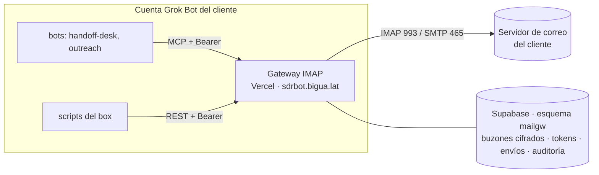

# Gateway IMAP/SMTP para clientes con correo IMAP

El cliente del piloto tiene sus buzones en un servidor IMAP/SMTP genérico, no en Google Workspace ni en Microsoft 365. El box de Grok Bot bloquea SMTP e IMAP (`06-respuestas-grokbot.md` A1), así que el bot no puede hablar con esos buzones directamente. La solución es un gateway propio de Biguá fuera del box: habla IMAP y SMTP con el servidor del cliente y le expone al bot y a los scripts una API HTTPS y herramientas MCP, que el box sí deja pasar.

El gateway está construido y probado en este repo (`gateway/`). Falta desplegarlo: necesita el proyecto de Supabase del SDR BOT, que todavía no existe, y un proyecto de Vercel.

## 1. Dónde encaja

Es un cuarto camino para el canal de mail, al lado de los tres de `02-arquitectura.md` §4.2. Para el bot y los scripts, una casilla IMAP se ve igual que las demás: se lee, se responde, se marca y se envía con el mismo cupo y la misma idempotencia.

| Proveedor del buzón del cliente | Cómo llega el bot |
|---|---|
| Google Workspace | Gmail API con delegación de dominio (estándar) |
| Microsoft 365 | Microsoft Graph (alternativa) |
| **IMAP/SMTP genérico** (hosting, cPanel, Plesk, Zimbra, servidor propio) | **Gateway IMAP de Biguá** (este documento) |
| Cualquiera, tenant chico | Conectores de Grok Bot (respaldo) |

## 2. Decisión: construirlo sobre el stack de Biguá

| Opción | A favor | En contra | Decisión |
|---|---|---|---|
| **Gateway propio en Vercel + Supabase** | Mismo stack que ASCI (Vercel, Postgres, MCP sin sesión); las reglas del SDR (cupo, idempotencia, no borrar) viven adentro; sin otro subencargado de datos; costo marginal casi nulo | Sin IMAP IDLE; 60 segundos por llamada; sin IP fija de salida | **Elegida** para el piloto |
| Contenedor siempre encendido (Fly.io, Railway, Cloud Run) con el mismo código | IDLE y push; IP fija posible | Otro proveedor para operar y monitorear | **Plan B** si el servidor del cliente exige IP fija o si la latencia de 15 minutos no alcanza. El código ya corre en Node como servidor (`src/server.mjs`) |
| EmailEngine (IMAP a REST, autohospedado) | Producto maduro, webhooks | Licencia anual, necesita Redis y un host siempre encendido; las reglas del SDR igual hay que escribirlas | Descartada |
| Nylas, Unipile (SaaS) | Sin infraestructura | Precio por buzón; los mails del cliente pasan por un tercero más, que hay que sumar al DPA | Descartada |

## 3. Qué hace

Doce operaciones, cada una disponible como `POST /v1/<op>` (para los scripts) y como tool MCP (para los bots). La lista completa, los códigos de error y los ejemplos están en `gateway/README.md`.

- **Leer:** sincronizar con cursor, buscar, leer un mensaje. Cada mensaje trae el texto, el texto sin la cita (`reply_text`), las cabeceras de hilo para cruzar con lo enviado, y si es respuesta automática o rebote.
- **Responder:** en el mismo hilo, desde el mismo buzón, con cita, guardando la copia en Enviados y marcando el original como respondido.
- **Borradores:** la respuesta queda en la carpeta Borradores del buzón y una persona la manda desde su programa de correo. Es la forma más simple de que "nada salga sin el OK del cliente" sin construir todavía la tabla de aprobaciones.
- **Enviar:** mails nuevos por el SMTP del buzón, con cupo diario, idempotencia y `List-Unsubscribe`.
- **Gestionar:** marcas (`\Seen`, `\Answered`, `\Flagged` y palabras clave como `SDR_procesado`), mover a otra carpeta, crear carpetas. Borrar no: lo hace una persona.
- **Verificar:** probar el acceso IMAP y SMTP de un buzón sin enviar nada, para el chequeo de las 07:30.

## 4. Seguridad

| Riesgo | Control |
|---|---|
| Biguá guarda la contraseña de un buzón del cliente | Cifrada con AES-256-GCM; la llave está sólo en Vercel (`MAILGW_ENC_KEYS`), nunca en la base; el texto cifrado está atado a su buzón. La contraseña entra por la CLI de un operador, sin pasar por mail ni chat. El DPA tiene que decir que Biguá guarda credenciales de acceso al correo |
| Un token filtrado | Hash en la base, vencimiento, revocación, permisos separados (`read`, `draft`, `send`, `manage`) y alcance limitado a los buzones de su cliente |
| El bot manda de más o duplica | Cupo diario atómico por buzón, clave de idempotencia obligatoria (probado con pedidos simultáneos), máximo 10 destinatarios, permiso `send` aparte |
| El bot borra algo | No hay operación para borrar, ni `\Deleted`, ni mover a la papelera |
| El hosting bloquea la cuenta o la IP por intentos fallidos | Tres contraseñas rechazadas seguidas bloquean el buzón en el gateway y deja de intentar hasta que un operador lo reactiva |
| Superficie de administración expuesta | No hay endpoints de administración: el alta de clientes, buzones y tokens se hace con la CLI desde la máquina de un operador |
| Trazabilidad | `mailgw.audit_log`: token, buzón, operación, resultado y conteos, sin contenido de mensajes |

## 5. Qué necesitamos del cliente

| # | Ítem | Detalle | Bloqueante |
|---|---|---|---|
| 1 | Buzones | Las direcciones que va a usar el bot. Recomendado: buzones dedicados al SDR, no la casilla personal del vendedor | Sí |
| 2 | Datos de conexión | Servidor y puerto IMAP (normalmente 993 con SSL) y SMTP (465 con SSL o 587 con STARTTLS), y el usuario si no es la dirección completa | Sí |
| 3 | Contraseña de cada buzón | Si el proveedor ofrece contraseñas de aplicación, una de esas. Se carga en una videollamada con un operador de Biguá, que la escribe en la CLI; nunca por mail | Sí |
| 4 | Acceso desde afuera | Confirmar con el hosting que IMAP y SMTP aceptan conexiones desde cualquier IP, sin lista de IPs permitidas ni bloqueo por país. Si exigen IP fija, ver §7 | Sí |
| 5 | Límite de envío del hosting | Cuántos mails por hora y por día permite el plan. El cupo del gateway se fija por debajo | Sí para enviar |
| 6 | SPF, DKIM y DMARC | Que el dominio autorice al servidor SMTP del hosting; si no, los mails van a spam | Sí para enviar |
| 7 | Copia de enviados | Si el servidor ya guarda en Enviados lo que sale por SMTP, para no duplicar la copia | No |
| 8 | Aprobador | Quién revisa los borradores de respuesta y los manda | Sí |

## 6. Cómo trabaja el bot en el piloto

La base de control todavía no está construida, así que el piloto usa el propio buzón como estado: lo que el bot ya procesó lleva la palabra clave `SDR_procesado`. Si el servidor no admite palabras clave (`marcar` devuelve `keywords_allowed: false`), se usa el cursor de `sincronizar` guardado en un archivo del box.

**Routine de monitoreo** (bot `handoff-desk`, cada 15 minutos en horario hábil):

1. `buscar` en INBOX con `not_keyword: "SDR_procesado"` y `since` = fecha de arranque del piloto.
2. Para cada mensaje, `leer_mensaje` y clasificar con `reply_text`.
3. Según la clasificación:
   - **Caliente o tibio:** `crear_borrador` con `reply_to` (queda en Borradores, en el hilo), avisar al aprobador, `marcar` con `\Flagged` y `SDR_caliente` o `SDR_tibio`.
   - **Baja:** `marcar` con `SDR_baja` y anotar la dirección en la lista de no contactar del piloto.
   - **Fuera de oficina o rebote** (`is_auto_reply`, `is_bounce`): `marcar` con `SDR_auto` o `SDR_rebote`.
   - **No por ahora, no interesado:** borrador con la respuesta estándar o sólo la marca, según el criterio del cliente.
4. `marcar` cada mensaje procesado con `SDR_procesado`.

**Envíos.** La primera semana el token del piloto lleva sólo `read`, `draft` y `manage`: todo lo que el bot escribe queda como borrador y lo manda una persona. Con los textos aprobados se agrega `send` en un token nuevo, y los primeros toques salen por script con `enviar`, una clave de idempotencia por mensaje y el cupo del buzón.

**Prompt de la routine.** Tiene que decir con todas las letras que el bot crea borradores y no envía, y que si una tool devuelve `mailbox_blocked` o `mail_auth_failed` se detiene y avisa.

## 7. Riesgos y límites

| Riesgo | Impacto | Mitigación |
|---|---|---|
| El servidor del cliente sólo acepta IPs de una lista o bloquea países | No conecta | Confirmarlo antes (§5.4). Si pasa: Vercel con IP fija, si el plan lo permite, o el mismo código en un contenedor con IP fija (plan B de §2) |
| Límite de envío del hosting compartido, o IP del hosting con mala reputación | Mails rechazados o en spam | Cupo del gateway por debajo del límite del plan; SPF, DKIM y DMARC; volumen bajo, que es el del SDR |
| Latencia de hasta 15 minutos | Un urgente espera hasta la próxima corrida | Alcanza para el piloto; si no, plan B con IDLE |
| Un buzón grande hace lenta la primera lectura | Llamadas cerca de los 60 segundos | `since` con la fecha de arranque; `limit` bajo |
| Un envío cortado a mitad | La clave queda bloqueada | El operador revisa Enviados y la libera con `clear-send` (`gateway/README.md`) |
| Contraseña cambiada por el cliente | El buzón se bloquea a la tercera falla | Alerta al operador; `set-password` lo reactiva |

## 8. Pasos para arrancar el piloto

| # | Paso | Quién | Estado |
|---|---|---|---|
| 1 | Crear el proyecto de Supabase `sdrbot` (misma organización y región que `locasci`) | Biguá | Hecho el 04/11: `rrieaxdmrikhhgzuvvzb`, `sa-east-1` |
| 2 | Crear el proyecto de Vercel desde este repo con Root Directory `gateway`; conectarle el Supabase `sdrbot` desde Storage (carga `POSTGRES_URL`); variable `MAILGW_ENC_KEYS`; dominio `sdrbot.bigua.lat` | Biguá | Hecho el 04/11 salvo `MAILGW_ENC_KEYS`: proyecto `sdrbot-mail-gateway` conectado al repo y a la base, en `https://sdrbot.bigua.lat`, región `gru1`; `/health` responde |
| 3 | Migración del esquema `mailgw` | Biguá | Hecho el 04/11: siete tablas con seguridad por filas, sin acceso para `anon` ni `authenticated` |
| 3b | `add-client` del cliente piloto | Biguá | Hecho el 04/11: cliente `bairesqa` (BairesQA) |
| 4 | Recibir del cliente los ítems de §5 | Cliente | Pendiente |
| 5 | `add-account` y `check` por cada buzón, en videollamada con el cliente | Biguá + cliente | Pendiente |
| 6 | `add-token` con `read,draft,manage`; cargarlo en la cuenta de Grok Bot como conector MCP y como secreto `MAILGW_TOKEN` | Biguá | Pendiente |
| 7 | Routine de monitoreo con el prompt de §6; una semana sólo con borradores | Biguá | Pendiente |
| 8 | Token con `send` para los primeros toques, con el cupo fijado según §5.5 | Biguá + cliente | Después de aprobar los textos |
