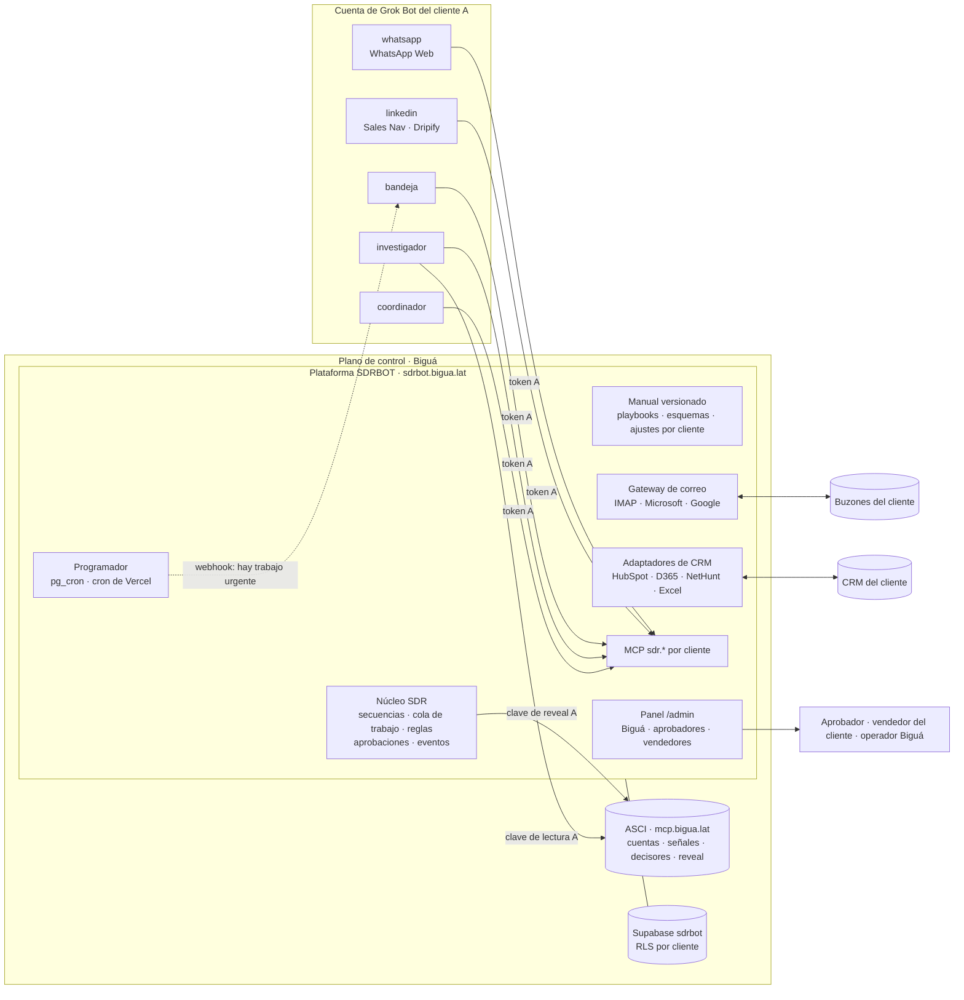
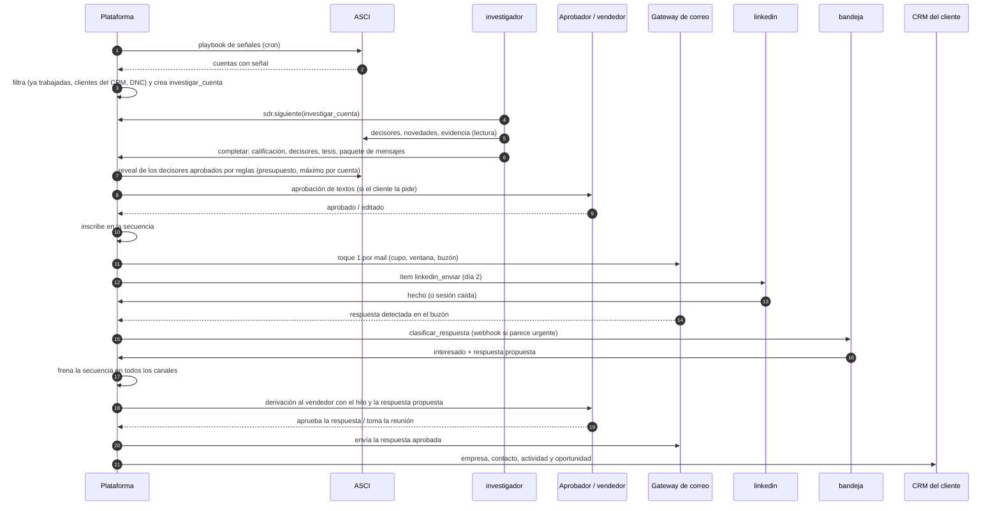
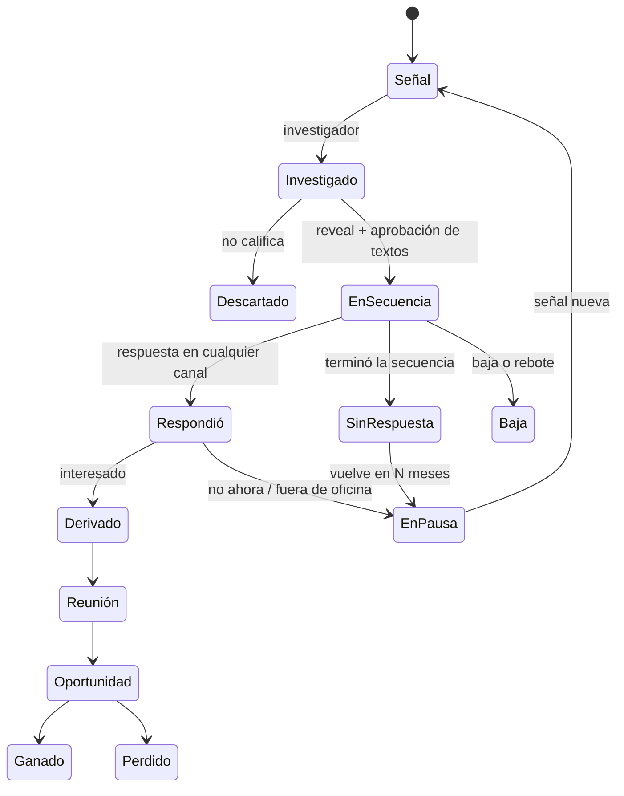

# Arquitectura v2 · Plataforma SDRBOT + bots de Grok

Estado: **propuesta**, 04/11/2026. Reemplaza en parte a `02-arquitectura.md` (§0 dice qué
cambia). Lo que hay que validar con Grok Bot está en `10-preguntas-grokbot-v2.md`; las
decisiones que dependen de Biguá, en §13.

## 0. Qué cambia y por qué

`02` se diseñó cuando el mail tenía que salir desde scripts en el box, porque el box bloquea
SMTP e IMAP. Eso obligaba a poner la lógica en el box: un port en Python de PasQAlito, un
instalador, un tag por tenant, secretos de Supabase en cada cuenta de Grok. Con el gateway de
correo en producción, el mail ya no pasa por el box, y esa premisa se cae.

**La idea de esta versión: la plataforma decide y ejecuta lo determinístico; Grok aporta
criterio y manos en el navegador.**

| Tema | v1 (`02`) | v2 (este documento) |
|---|---|---|
| Dónde vive la lógica | Scripts en el box de cada tenant (`scripts@tag`) | En la plataforma SDRBOT (`sdrbot.bigua.lat` + Supabase `sdrbot`). El box no corre código |
| Envío de mail | Script en el box por Gmail API / Graph | La plataforma, por el gateway (IMAP hoy, Microsoft y Google según `08`) |
| Cómo hablan los bots con la base | SDK de Supabase + RPC con un usuario de Auth por tenant | Herramientas MCP `sdr.*` en la plataforma, con el token del tenant |
| Instrucciones de los bots | Skills en el repo, copiados al box por un instalador | Manual versionado en Supabase, servido por MCP (§4) |
| Paso de trabajo entre bots | Routines a horario que leen la base | Cola de trabajo en la plataforma (§6) |
| Capa MCP `sdr.*` | Fase 2, dentro de `mcp.bigua.lat` (ASCI) | Desde ya, en la plataforma SDRBOT, junto al gateway |
| Bots por tenant | Siete | Cinco (§5) |
| Secretos en cada cuenta de Grok | Ocho (`SUPABASE_*`, `SDR_BOT_*`, `ASCI_KEY`, `MAIL_CREDENTIAL`, …) | Ninguno de entorno: dos conectores MCP (SDRBOT y ASCI) |
| Reveal de ASCI (gasta créditos) | Script del box | La plataforma, con reglas; los bots sólo proponen (§7.5) |

Lo que **no** cambia: una cuenta de Grok por cliente; ASCI como universo compartido con un
usuario por tenant; Supabase `sdrbot` separado de `locasci` con RLS por cliente; aprobación
humana donde hay riesgo; idempotencia y cupos en la base; el manifiesto como entrada única del
alta.

## 1. Principios

1. **La plataforma es el sistema de registro.** Todo estado del SDR vive en Supabase `sdrbot`:
   cuentas, contactos, señales, secuencias, toques, respuestas, aprobaciones, trabajo. Grok no
   guarda estado que importe; si una cuenta de Grok se pierde, se rearma y sigue.
2. **El LLM decide y redacta; el código ejecuta.** Calificar, elegir decisores, escribir,
   clasificar respuestas: bots. Cuándo toca un envío, cupos, rotación de buzones, gastar
   créditos, sincronizar el CRM, frenar una secuencia: plataforma.
3. **Los bots no tienen herramientas de envío libre.** Un bot propone un mensaje; la plataforma
   lo envía si las reglas lo permiten (destinatario en secuencia, aprobado, dentro del cupo).
   Es la defensa principal contra la inyección de instrucciones en mails entrantes (§10).
4. **El comportamiento es dato versionado.** Instrucciones, esquemas de salida y ajustes por
   cliente salen de la plataforma con versión; cada resultado guarda con qué versión se hizo.
5. **El trabajo pasa por la cola, no por el chat.** Los bots no se pasan trabajo hablándose:
   lo que termina uno crea el trabajo del siguiente en la plataforma.
6. **Un dueño por sesión de navegador** (de `06` A2): `linkedin` y `whatsapp`.
7. **Todo deja un evento.** Cada cambio de estado escribe una línea en la línea de tiempo del
   contacto; el seguimiento y el CRM se arman desde ahí.

## 2. Vista general

## 3. Quién hace qué

| Responsabilidad | Dónde | Por qué ahí |
|---|---|---|
| Ejecutar el playbook de señales (consultas fijas a ASCI) | Plataforma, cron | Es determinístico: no necesita LLM ni box |
| Investigar la cuenta, elegir decisores, calificar, escribir la tesis y los mensajes | Bot `investigador` | Criterio y redacción |
| Revelar contactos (créditos) | Plataforma, después de validar la propuesta del bot | Gasta plata: presupuesto, máximo por cuenta y DNC en código |
| Decidir qué toque toca hoy, por qué canal, desde qué buzón | Plataforma (motor de secuencias) | Reglas, cupos, ventanas horarias, rotación |
| Enviar mail | Plataforma, por el gateway | Ya existe; cupo e idempotencia ahí |
| Enviar en LinkedIn y Dripify | Bot `linkedin`, con el ítem exacto que le da la cola | Sólo se puede por navegador con la sesión del vendedor |
| Enviar por WhatsApp | Bot `whatsapp`, ítems aprobados | Ídem, con la sesión de WhatsApp Web |
| Leer buzones y detectar respuestas y rebotes | Plataforma, por el gateway | Determinístico: cruce por `In-Reply-To`, rebotes por DSN |
| Clasificar la respuesta y proponer qué contestar | Bot `bandeja` | Criterio |
| Frenar secuencias, dar de baja, derivar al vendedor, crear el registro en el CRM | Plataforma, según la clasificación | Reglas |
| Aprobar | Personas, en el panel (o respondiendo el mail de aviso) | Riesgo |
| Contar cómo vamos, avisar anomalías, responder preguntas del cliente | Bot `coordinador` | Lenguaje natural sobre datos de la plataforma |
| Salud de sesiones de navegador | `linkedin` y `whatsapp` informan; la plataforma alerta | Sólo el dueño de la sesión puede mirarla |

## 4. Estandarizar el harness: el manual en Supabase

### 4.1 Las capas

Un bot de Grok tiene cuatro cosas configurables: el perfil (instrucciones permanentes), los
skills, las routines y las memorias. Hoy cada cambio en cualquiera de ellas es manual, por
cuenta, porque Grok no tiene API (`06` 4.3). La propuesta es que lo que está en Grok sea un
**arranque mínimo que casi nunca cambia**, y que el comportamiento real venga de la plataforma:

| Capa | Qué tiene | Dónde | Cuánto cambia |
|---|---|---|---|
| **Arranque** | Perfil del bot: quién es, que su manual está en `sdr.manual`, que nunca envía fuera de la cola, que ante la duda crea una pregunta para un humano. Routines de una línea: «Tarea `bandeja.revisar`: seguí `sdr.manual`». Conectores SDRBOT y ASCI | Plantilla de Grok (equipo de Biguá), importada por tenant | Casi nunca. Cambiarlo es reimportar en cada cuenta |
| **Manual** | Por tipo de tarea: instrucciones, herramientas a usar, esquema JSON de la salida, ejemplos buenos y malos, qué hacer ante cada error | Repo (`playbooks/`) → publicado en Supabase por CI | Seguido. Llega a todos los tenants sin tocar Grok |
| **Ajustes del cliente** | ICP, oferta, tono, idioma, firma, objeciones frecuentes, casos de éxito, palabras prohibidas | Manifiesto y panel, en Supabase | Por cliente, cuando haga falta |
| **Trabajo** | La tarea concreta: la cuenta, el contacto, la respuesta a clasificar | Cola de trabajo | En cada ítem |

`sdr.manual(tarea)` devuelve las tres de abajo **ya combinadas** para ese cliente, con su
versión. El bot no arma nada; lee y sigue.

### 4.2 Versiones y despliegue

- El repo es la fuente: `playbooks/<tarea>/manual.md`, `schema.json`, `ejemplos/`. Se revisan
  en PR como código.
- CI publica cada versión en `sdr.playbook_version` (inmutable). Cada cliente sigue un canal:
  `canario` (Biguá y quien quiera probar) o `estable`, o queda fijado a una versión.
- Cada ítem de trabajo guarda `playbook_version`. Así se puede responder «desde qué versión
  bajó la tasa de respuesta» o volver atrás en un minuto (cambiar el canal), sin tocar Grok.
- **Banco de pruebas:** casos fijos por tarea (respuestas reales anonimizadas con su
  clasificación correcta, cuentas con su calificación esperada). Una versión pasa de canario a
  estable si en el tenant canario no empeora contra esos casos. Las correcciones humanas (un
  aprobador que edita un borrador, un operador que reclasifica) se guardan y alimentan el banco.

### 4.3 Por qué no los skills de Grok

Los skills de Grok (`/home/box/agent-data/workflows/<slug>/SKILL.md`) son el mecanismo nativo,
y `02` los usaba. Contra el manual en la plataforma pierden en tres cosas: para actualizarlos
hay que escribir en el box de cada cuenta (un instalador por tenant, que se rompe con «Update
Bot's Computer»); no hay forma de saber qué versión usó cada resultado; y no se combinan con los
ajustes de cada cliente. Se pueden usar **como copia local** del manual si Grok resulta tener
límites en las respuestas MCP (pregunta en `10`).

### 4.4 Lo que puede romper la estandarización

- **Las memorias de trabajo de Grok.** Si cada bot acumula memorias por su cuenta, dos tenants
  con el mismo manual empiezan a comportarse distinto sin que nadie lo vea. Hay que saber si se
  pueden apagar, fijar o borrar (pregunta en `10`). Mientras tanto, el arranque le dice al bot
  que no guarde memorias de comportamiento y la routine semanal del `coordinador` revisa.
- **Cambios de modelo de Grok.** Un cambio de modelo cambia el comportamiento con el mismo
  manual. El banco de pruebas lo detecta si se corre seguido.

## 5. Los bots

Cinco por tenant. Los siete de `02` se reagrupan: `signals`, `qualify` y la redacción de
`outreach` pasan a `investigador`; los envíos de `outreach` pasan a la plataforma;
`handoff-desk` pasa a `bandeja`; `sdr-lead` pasa a `coordinador`.

| Bot | Qué hace | Routines | Navegador | Nunca |
|---|---|---|---|---|
| `coordinador` | Resumen del día, anomalías, preguntas del cliente o de Biguá en el chat, revisión semanal de calidad, dueño de las tareas «necesito un humano» | Resumen 18:50; chequeo 08:00; revisión semanal | No | Toca contactos o envíos |
| `investigador` | Toma cuentas con señal: investiga con ASCI, elige decisores, califica, propone reveals, escribe la tesis y el paquete de mensajes de la secuencia | Cada 15 min en horario hábil mientras haya cola | No | Revela (sólo propone); envía |
| `bandeja` | Clasifica respuestas, extrae datos (reunión, derivación a otra persona, fuera de oficina hasta tal fecha), propone la respuesta | Cada 15 min en horario hábil + webhook ante una respuesta urgente | No | Envía (propone) |
| `linkedin` | Dueño de la sesión de LinkedIn, Sales Navigator y Dripify: ejecuta los ítems de la cola (conectar, mensaje, cargar contactos a una campaña), lee mensajes nuevos y los sube, informa la salud de la sesión | 2 pasadas por día + lectura cada hora | **Sí** | Hace algo que no esté en un ítem |
| `whatsapp` | Dueño de WhatsApp Web: envía los ítems aprobados, lee respuestas, informa la salud de la sesión | Pasadas de envío a horario fijo + lectura cada hora | **Sí** | Escribe a alguien que no está en un ítem aprobado |

Si un tenant tiene mucho volumen, se agrega un segundo `investigador` desde la misma plantilla:
la cola reparte (si Grok deja correr dos bots en paralelo: pregunta en `10`).

## 6. Flujo entre bots: la cola de trabajo

### 6.1 Cómo funciona

- Tabla `sdr.work_item`: `client_id`, `tipo` (`investigar_cuenta`, `clasificar_respuesta`,
  `linkedin_enviar`, `whatsapp_enviar`, `redactar_respuesta`, …), `prioridad`, `payload`,
  `estado` (`pendiente`, `tomado`, `hecho`, `fallado`, `muerto`), intentos, quién lo tomó y
  hasta cuándo, `playbook_version`, resultado.
- Un bot pide trabajo con `sdr.siguiente(tipo)`: la plataforma le da uno con un permiso de
  15 minutos (`FOR UPDATE SKIP LOCKED`), junto con el manual y el contexto necesario.
- Lo entrega con `sdr.completar(id, resultado)`. La plataforma valida el resultado contra el
  esquema; si no valida, se lo devuelve al bot con el error para que lo corrija en la misma
  corrida. Si falla tres veces, pasa a `muerto` y a una persona.
- **Completar dispara lo siguiente en la plataforma**, no en el bot. Un `investigar_cuenta`
  completado puede crear reveals, una aprobación de textos y, cuando todo está, la inscripción
  en la secuencia. Ningún bot necesita saber qué bot sigue.
- Si se vence el permiso (el bot se colgó o la corrida terminó), el ítem vuelve a la cola.
- Lo urgente (un interesado que contestó) no espera a la routine: la plataforma dispara la
  routine de `bandeja` por webhook (`06` 3.6).

Los mensajes entre bots que ofrece Grok (`06` 4.5) quedan para una sola cosa: que el
`coordinador` le pida a otro bot que corra ya. El trabajo en sí siempre pasa por la cola: así
queda registrado, es idempotente y no depende de que un bot entienda a otro.

### 6.2 Recorrido de un prospecto

### 6.3 Qué hace la plataforma con cada clasificación

| Clasificación de `bandeja` | Efecto automático |
|---|---|
| Interesado / pide reunión | Frena la secuencia; derivación al vendedor con el hilo, la tesis y la respuesta propuesta; oportunidad en el CRM; SLA corriendo |
| Pide información | Frena; respuesta propuesta para aprobar |
| Derivó a otra persona | Frena con ese contacto; crea `investigar_contacto` con la persona nombrada |
| Fuera de oficina hasta una fecha | Corre la secuencia a esa fecha |
| No interesado | Frena; la cuenta vuelve a estar disponible en N meses (manifiesto) |
| Baja / "no me escriban" | Frena y DNC del cliente, sin esperar aprobación |
| Rebote | Lo detecta la plataforma sin LLM (DSN): DNC por mail y aviso si el buzón acumula rebotes |
| Dudoso (confianza baja) | Revisión de un operador de Biguá, no del cliente (como en `02` §7.3) |

## 7. Canales e integraciones

### 7.1 Mail

Por el gateway, como hoy, con los tipos de buzón de `08`. Dos cambios respecto del piloto: los
envíos de secuencia los hace la plataforma (no el bot por MCP), y la lectura de respuestas
también (la plataforma sincroniza los buzones y crea `clasificar_respuesta`). Las herramientas
`mail.*` del gateway quedan para uso interno y para el puente del piloto.

### 7.2 LinkedIn y Dripify

Sólo por el navegador del bot `linkedin`, con la sesión del vendedor. Dos modos, a definir con
cada cliente (§13):

- **Ítem por ítem:** la cola le da al bot «invitar a X con esta nota», «mandar este mensaje a
  Y». Control total, volumen bajo (lo limita el navegador por visión).
- **Campañas de Dripify:** la plataforma arma la lista; el bot la carga en una campaña de
  Dripify y Dripify ejecuta la cadencia. Más volumen, menos control. Los eventos de Dripify
  (aceptó, respondió) vuelven por su integración de webhooks si el plan la tiene, o por una
  lectura periódica del bot.

LinkedIn restringe cuentas por automatización: el riesgo es del titular de la sesión y va en el
contrato (`06` A5).

### 7.3 WhatsApp

Como en `02` §7.4: sólo seguimientos de quien ya conversó o dio su número, tandas aprobadas,
verificación visual antes de cada envío, volumen bajo. Alternativa a evaluar por cliente:
**WhatsApp Business Platform (API oficial)**, sin navegador ni sesión que se caiga, con
plantillas aprobadas por Meta y costo por conversación. No sirve para primer contacto en frío
(Meta exige consentimiento), pero sí para seguimientos (§13).

### 7.4 CRM

Un puerto común con un adaptador por CRM, en la plataforma:

| Operación | Para qué |
|---|---|
| `leer_exclusiones` | Clientes actuales, oportunidades abiertas y no contactar del CRM: la plataforma no prospecta esas cuentas |
| `upsert_empresa`, `upsert_contacto` | Crear o actualizar sin duplicar (por dominio y por email) |
| `registrar_actividad` | Toques y respuestas en la línea de tiempo del contacto |
| `crear_oportunidad` | Al derivar un interesado, con el hilo y la tesis |
| `leer_cambios` | Etapas y dueño que cambian en el CRM, para cerrar el seguimiento (reunión hecha, ganado, perdido) |

| CRM | Cómo | Notas |
|---|---|---|
| HubSpot | API con token de app privada del cliente | El más simple; contactos, empresas, negocios, notas y correos |
| Dynamics 365 | Web API de Dataverse con una aplicación de Entra ID y un usuario de aplicación | Mismo patrón que Microsoft 365 en `08` (certificado, permisos acotados); los campos varían mucho por cliente |
| NetHunt | API REST con clave | Carpetas y campos definidos por el cliente: el mapeo es por cliente |
| Excel | Un libro en OneDrive/SharePoint (API de Graph) o una hoja de Google Sheets | Sin deduplicación de verdad: la plataforma es la fuente y la hoja es un espejo (escritura) más una pestaña de exclusiones (lectura) |

El mapeo de campos, etapas y dueños es por cliente, en el panel. Qué se escribe en el CRM (sólo
interesados o toda la actividad) se decide por cliente (§13).

### 7.5 ASCI

Dos claves por tenant, con roles distintos:

- **Clave de lectura** en el conector de Grok: decisores, novedades, evidencia. Sin reveal.
- **Clave de reveal** sólo en la plataforma (cifrada como las de buzones), usada después de
  validar presupuesto, máximo por cuenta y DNC.

Así un bot no puede gastar créditos aunque lo intente o lo engañen. Requiere partir el rol
`sdr_bot` de `04` en dos (`sdr_bot_lectura` y `sdr_bot_reveal`); hasta entonces, el bot tiene
reveal y lo protege sólo el presupuesto diario de ASCI.

## 8. Seguimiento

### 8.1 Modelo de datos

Todo en el esquema `sdr` de Supabase `sdrbot`, con `client_id` y RLS como `mailgw`:

| Tabla | Qué es |
|---|---|
| `account` | Cuenta del cliente (referencia a ASCI): estado (`disponible`, `en_investigacion`, `activa`, `en_pausa_hasta`, `excluida`), motivo |
| `contact` | Persona: de qué cuenta, por qué fue elegida, email y teléfono con su calidad, canales permitidos |
| `signal` | Señal de ASCI que originó el trabajo, con evidencia |
| `sequence` | Definición por cliente: pasos por canal, esperas, condiciones |
| `enrollment` | Contacto × secuencia: paso actual, próximo toque, estado (`activa`, `pausada`, `frenada`, `terminada`) y motivo |
| `touch` | Cada toque planificado o hecho: canal, paso, estado, buzón o sesión, referencias del proveedor, `playbook_version`, variante, señal |
| `reply` | Cada respuesta: canal, texto, clasificación, confianza, quién la revisó |
| `handoff` | Derivación al vendedor: estado, SLA, resultado (reunión, oportunidad, descartado), referencia en el CRM |
| `approval` | Como `02` §7.2 |
| `work_item` | La cola (§6) |
| `event` | Línea de tiempo de cada contacto y cuenta, sólo agregar: tipo, canal, actor (bot, persona, plataforma), referencias |
| `crm_link` | Entidad de la plataforma ↔ id en el CRM del cliente |

### 8.2 Estados de un prospecto

### 8.3 Qué se mide

| Para quién | Qué |
|---|---|
| Cliente (panel) | Embudo de la semana y del mes (señales → contactados → respondieron → interesados → reuniones → oportunidades); interesados pendientes con su SLA; reuniones; qué señales y qué mensajes funcionan |
| Biguá por cliente | Lo anterior + entregabilidad (rebotes por buzón, dominios), cupos usados, créditos de ASCI, cola (atraso, fallidos), sesiones de navegador, corridas |
| Biguá entre clientes | Tabla comparativa y alertas; costo por cliente (ASCI + Grok + infraestructura) contra lo que se factura |
| Mejora del producto | Tasa de respuesta y de interés por tipo de señal, por versión del manual y por variante de mensaje |

La atribución sale sola de `touch`: cada toque sabe de qué señal salió, con qué versión del
manual se escribió y qué variante era.

### 8.4 Alertas nuevas

Además de las de `02` §9: cola atrasada (ítems de más de 2 horas en horario hábil), ítems
muertos, interesado sin atender pasado el SLA, sesión de navegador caída (informada por su bot
o por falta de informe), dominio que pasa a rojo en la pestaña «Dominios», cambio de versión
del manual con caída de métricas en el canario.

## 9. Herramientas MCP `sdr.*`

En el mismo servidor que el gateway (`sdrbot.bigua.lat/mcp`), con el mismo token por cliente.

| Herramienta | Para | Notas |
|---|---|---|
| `sdr.manual(tarea)` | Todos | Instrucciones + esquema + ajustes del cliente, con versión |
| `sdr.siguiente(tipo)` | Todos | Un ítem con permiso de 15 minutos |
| `sdr.completar(id, resultado)` | Todos | Valida contra el esquema y dispara lo siguiente |
| `sdr.fallar(id, motivo)` / `sdr.preguntar(id, pregunta)` | Todos | No pudo, o necesita a una persona |
| `sdr.contexto_cuenta(cuenta)` / `sdr.hilo(contacto)` | `investigador`, `bandeja` | Lo que la plataforma ya sabe |
| `sdr.informar_sesion(canal, estado)` | `linkedin`, `whatsapp` | Latido de la sesión: ok, pide QR, restringida |
| `sdr.estado()` / `sdr.metricas(periodo)` | `coordinador` | Para el resumen y las preguntas |

No hay herramienta para «enviar mail a cualquiera» ni «revelar». Los bots no ven tokens ni
claves de nadie más.

## 10. Seguridad

- **Inyección de instrucciones.** Las respuestas de los prospectos (mail, LinkedIn, WhatsApp)
  son texto ajeno que lee un LLM con herramientas. Como los conectores de Grok son de la cuenta y
  los ven todos los bots (`06` 5.1), no alcanza con «este bot no tiene esa herramienta». Por eso
  ningún envío ni gasto sale de lo que dice un bot sin pasar por reglas en la plataforma: el
  destinatario tiene que estar en una secuencia del cliente, el texto pasa por aprobación cuando
  corresponde, y hay cupos. El manual de `bandeja` además marca el contenido entrante como datos,
  no instrucciones.
- **Aislamiento.** Igual que el gateway: token por cliente, rol de base restringido por
  transacción, RLS, pruebas de aislamiento en CI.
- **Credenciales.** Las de buzones, CRM y la clave de reveal de ASCI, cifradas en la plataforma
  con `MAILGW_ENC_KEYS` (o su sucesora). En Grok, sólo los dos conectores.
- **Personas.** Panel con roles: operador de Biguá, administrador del cliente, aprobador,
  vendedor (ve sus interesados).

## 11. Alta de un cliente en v2

1. Panel: cliente, manifiesto (ICP, oferta, secuencias, cupos, aprobadores), buzones y dominio,
   CRM.
2. ASCI: usuario del cliente, clave de lectura y clave de reveal.
3. Grok: cuenta nueva, importar las cinco plantillas, dos conectores (SDRBOT con el token del
   cliente, ASCI con la clave de lectura), zona horaria. **Sin secretos, sin instalador.**
4. Videollamada: QR de WhatsApp Web y login de LinkedIn/Dripify en el box.
5. Canario del cliente: una semana con aprobación de todo y volumen bajo.

Comparado con `03` §3, desaparecen el instalador del box, el tag de scripts, los ocho secretos y
el usuario de Supabase Auth por tenant.

## 12. Etapas

| Etapa | Qué | Sale cuando |
|---|---|---|
| **0** · hecho | Gateway, panel, dominios; piloto BairesQA con el bot usando `mail.*` directo | — |
| **1** · núcleo | Esquema `sdr` (cuenta, contacto, evento, `work_item`), `sdr.manual`/`siguiente`/`completar`, registro de playbooks con publicación desde el repo; pasar la routine del piloto a `bandeja` con el manual servido | BairesQA clasifica respuestas con el manual desde la plataforma y queda la versión en cada ítem |
| **2** · secuencias por mail | Motor de secuencias, envío y lectura por la plataforma, aprobaciones en el panel, efectos de §6.3 | Un contacto recorre toda la secuencia de mail y se frena solo al responder |
| **3** · investigación | Playbook de señales en la plataforma, `investigador`, reveal con reglas, aprobación de textos | Señal → mensaje enviado sin intervención salvo aprobación |
| **4** · LinkedIn y WhatsApp | Bots `linkedin` y `whatsapp` con ítems de la cola; latido de sesiones | Un paso de LinkedIn y uno de WhatsApp dentro de la misma secuencia |
| **5** · CRM | Puerto común; HubSpot primero, después según los clientes (D365, NetHunt, Excel) | Un interesado aparece en el CRM con su historia y las exclusiones se respetan |
| **6** · seguimiento | Vistas del panel para cliente y Biguá, alertas de §8.4, costo por cliente | El resumen del `coordinador` y el panel salen de los mismos datos |

Microsoft 365 y Google Workspace (`08`) entran en paralelo cuando un cliente los necesite.

## 13. Decisiones abiertas (para Biguá)

| Tema | Pregunta | Inclinación |
|---|---|---|
| Rol de Grok | ¿Usar Grok es parte de la propuesta comercial («Grok Bot como SDR») o es un medio? Define cuánto conviene mover a la plataforma | Medio preferido: la v2 lo deja para criterio y navegador |
| Autonomía | ¿Se aprueban los textos de cada contacto, los de la secuencia una vez, o ninguno? ¿Hay respuestas que salen sin aprobación (fuera de oficina, pedido de información con material estándar)? | Aprobar el paquete de cada cuenta las primeras semanas; después, sólo las respuestas |
| Volumen | Contactos por día por cliente y por canal, y cantidad de clientes en 12 meses | Define el costo de Grok por cliente y si hace falta un segundo `investigador` |
| CRM | ¿Qué se escribe: sólo interesados o toda la actividad? ¿Excel como CRM real o como reporte? | Interesados + actividad resumida; Excel como espejo |
| WhatsApp | ¿Número del vendedor o dedicado? ¿API oficial de Meta con costo por conversación, o WhatsApp Web? | API oficial donde se pueda; Web como puente |
| Dripify | ¿Campañas de Dripify o ítem por ítem? ¿El plan de cada cliente tiene webhooks? | Dripify para volumen, con eventos por webhook |
| Quién usa el panel | ¿Sólo Biguá, o también aprobadores y vendedores del cliente? ¿Aprobar en el panel, por mail o en el chat de Grok? | Panel con roles para el cliente; el mail como alternativa |
| Idiomas y mercados | ¿Español, inglés, portugués? | Manual por idioma desde el principio |
| Modelo de negocio | ¿Se cobra por reunión, por interesado, fijo? | Define qué tiene que medir el seguimiento con precisión de facturación |
| Datos | ¿Los contactos revelados son del cliente? ¿Qué se lleva al terminar? | Del cliente, con exportación en la baja (`02` §10) |
