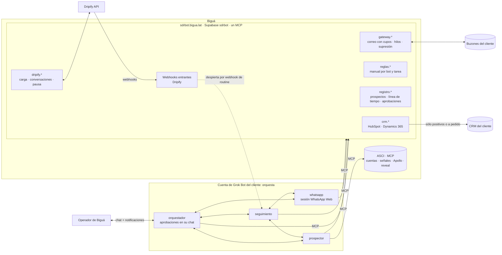
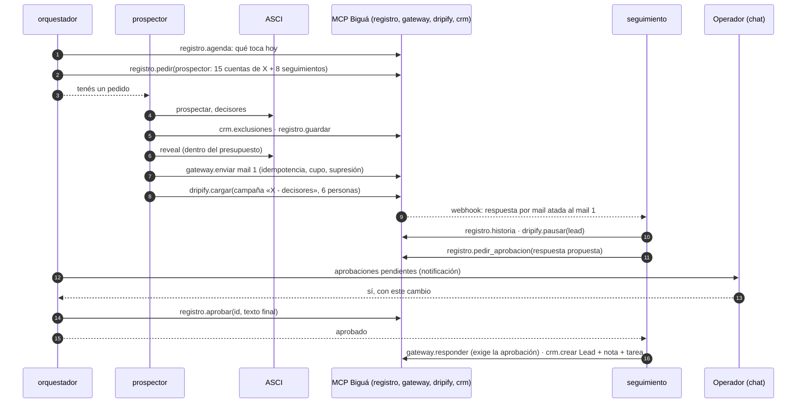

# Arquitectura v2 · Grok Bot como orquestador

Estado: **modelo definido por Biguá el 04/11/2026**, ajustado con las respuestas de Grok Bot del
mismo día (`12-respuestas-grokbot-v2.md`). Reemplaza a partes de `02-arquitectura.md` (§1 dice
cuáles). Los datos de la prospección, el CRM y el dashboard están en
`11-datos-crm-y-seguimiento.md`.

## 0. El modelo

1. **Grok Bot orquesta.** Los bots conversan sobre sus tareas y deciden el próximo paso con
   criterio. El proceso no es lineal ni lo dicta un motor de reglas externo.
2. **El gateway controla y documenta el correo:** límites de envío, respuestas y seguimiento de
   los hilos.
3. **El `prospector` prospecta de punta a punta:** cuentas nuevas en ASCI, Apollo a través del
   MCP de ASCI, tomadores de decisión, contenido del correo y envío por el gateway.
4. **LinkedIn por Dripify,** con campañas ya armadas. Los leads se cargan **por la API de
   Dripify** (no por el navegador) y Dripify corre la prospección. Dripify avisa por webhook.
5. **WhatsApp para seguimiento** cuando se tiene el número. El consentimiento ya está resuelto.
6. **Al CRM va lo positivo,** o lo que se le pida al bot. HubSpot primero; Dynamics 365 después.
7. **Supabase** tiene el gateway, **las reglas de operación de cada bot** (el harness, igual
   para todos los clientes) y **el registro de prospección** (la memoria de los bots, que es
   además el dashboard del cliente).
8. **Las aprobaciones las da un operador de Biguá en el chat del `orquestador`.** Más adelante,
   una capa para hacerlo desde Teams, Slack o mail.

## 1. Revisión: dónde choca con lo decidido antes

Fuentes: **v1.1** (documento original, revisado en `01`), **02** (`02-arquitectura.md`), **09a**
(la primera propuesta de este documento, «la plataforma decide», descartada; queda en el
historial de git), **G** (respuestas de Grok Bot, `12`).

| # | Antes | Ahora | A favor | En contra | ¿Viable? | Cómo queda |
|---|---|---|---|---|---|---|
| 1 | La base hace cumplir las reglas: cupos, no contactar, deduplicación, follow-ups, aprobaciones «viven en la base, no en la memoria de un bot» (v1.1, 02 §1) | Las decisiones las toman los bots | Proceso con criterio; mucho menos código propio | Un LLM puede olvidarse una regla, repetir un envío o equivocarse de persona | **Sí, con barandas** | §6: cada regla es **dura** (la impone el gateway, ASCI o Dripify) o **guía** (la sigue el bot) |
| 2 | Estado del SDR en Supabase con un esquema completo (v1.1, 02 §3) | Los bots deciden; al CRM va sólo lo positivo | — | Si el CRM sólo tiene positivos, los bots no tienen dónde recordar a los demás | **Sí** | **Registro de prospección** en Supabase: cuentas, prospectos y una línea de tiempo (`11` §3). Mucho más chico que el esquema de `02` |
| 3 | El trabajo entre bots pasa por la base (02 §7) o por una cola (09a) | Los bots conversan entre sí | Proceso no lineal; Grok lo soporta | El mensaje entre bots es asincrónico, sin latencia garantizada, y si el receptor está ocupado no se sabe qué pasa (G 1.2, 1.3, 1.5); cada mensaje cuesta | **Sí, con el registro como respaldo** | El pedido se escribe en el registro y el mensaje sólo despierta; cada bot revisa sus pedidos al empezar y al terminar (§4.3) |
| 4 | Reveal con filtro programático y presupuesto validado antes (02 §6.2) | El `prospector` revela por el MCP de ASCI | Simple | Puede gastar de más | **Sí** | Presupuesto diario de ASCI por usuario como baranda dura; falta el mensual (`04` §4.2). Antes de revelar, `crm.exclusiones` |
| 5 | Aprobación por mail con token (02 §7.2) | Aprobación en el chat del `orquestador` | Sin canal extra; el operador conversa con el bot | Las tarjetas de aprobación de Grok que nacen en una routine **vencen a los 30 minutos** (G 3.4) | **Sí** | Las aprobaciones son **datos en el registro**, no tarjetas de Grok; el gateway las exige antes de ejecutar (§5.4) |
| 6 | Envíos de mail desde scripts del box (02 §4.2) | El bot envía por el MCP del gateway | Ya funciona | La revisión automática de Grok revisa las llamadas MCP también desatendidas (G 3.4) | **Sí** | Regla **Allow** para las herramientas del MCP de Biguá; las barandas están en el gateway (§6, §11; `12` A.2) |
| 7 | Gateway sin memoria de los hilos | El gateway documenta respuestas y seguimiento | Una sola fuente del correo | Hay que construirlo | **Sí** | §7 |
| 8 | LinkedIn con un bot dueño de la sesión de Sales Navigator y Dripify (02); importación de CSV por el navegador (versión anterior de este documento) | **Dripify por su API** | Sin navegador ni sesión que se caiga; la API valida, deduplica y confirma la carga; se puede leer la conversación y pausar o bloquear a un lead | Límite de 60 pedidos por minuto y 5.000 por día por API key; requiere plan con API (G, Dripify §1) | **Sí** | Herramientas `dripify.*` en el MCP de Biguá con caché y límite (§5.3). **Ya no hay bot `linkedin`** |
| 9 | WhatsApp: tandas aprobadas, base legal declarada (v1.1, 02 §7.4) | Seguimiento cuando hay número | Más simple | Una sesión de WhatsApp Web por asiento de Grok (G 1.1) | **Sí** | Bot `whatsapp`; un número por cliente; dos números necesitan dos asientos |
| 10 | Documentación completa en el CRM | Al CRM sólo positivos o a pedido | El CRM del cliente queda limpio | Cada CRM guarda distinto | **Sí** | El bot decide los campos por `crm.*`, con límites duros y mapeo aprobado (`11` §5, §6) |
| 11 | Perfil de cada bot en Grok como arranque (versión anterior de este documento) | **No existe el perfil:** la identidad es memoria, y la memoria no se apaga (G 2.1, 2.2) | — | Lo que el bot «sabe de sí mismo» puede desviarse entre clientes | **Sí** | Cada routine se presenta sola y pide sus reglas; nada esencial depende de la memoria (§3) |
| 12 | Plantillas de Grok para dar de alta cada cuenta (02, 03) | Actualizar una plantilla no se propaga a las cuentas (G 2.4) | — | — | **Sí** | Alta por `reglas.alta()`: el `orquestador` crea las routines de todos los bots (Grok puede crear routines por herramienta, probado) (§9) |
| 13 | Siete bots (02) o cinco (versión anterior) | **Cuatro** | Menos mensajes entre bots (que cuestan) | — | — | `orquestador`, `prospector`, `seguimiento`, `whatsapp` (§4.1) |

## 2. Vista general

## 3. Reglas de operación centralizadas (el harness)

Grok Bot no tiene un perfil por bot y su memoria no se apaga (`12` A.1, punto 2). Por eso **nada
que tenga que ser igual entre clientes vive en el bot**:

| Capa | Qué tiene | Dónde | Cuánto cambia |
|---|---|---|---|
| **Routine** | Se presenta sola: «Sos el bot `prospector` del SDR de Biguá para el cliente X. Pedí tus reglas con `reglas.manual('prospector', 'diaria')` y seguilas. No uses lo que recuerdes de otras corridas para decidir: lo que vale está en el registro.» | En Grok, creada por `reglas.alta()` (§9) | Casi nunca |
| **Manual** | Por bot y por tarea: objetivo, pasos, criterios de decisión, a quién pedirle qué, qué registrar, qué hacer ante cada error, ejemplos | Repo (`playbooks/`) → publicado en Supabase con versión | Seguido; llega a todos los clientes sin tocar Grok |
| **Ajustes del cliente** | ICP, oferta, tono, idioma, firma, campaña de Dripify por segmento, límites, qué es positivo, mapeo del CRM aprobado | Supabase, editables en el panel | Por cliente |

- `reglas.manual(bot, tarea)` devuelve **un índice corto** y las secciones se piden de a una
  (`reglas.manual(bot, tarea, seccion)`): no se sabe cuánto texto aguanta una respuesta MCP en
  Grok (`12` A.3).
- Versiones con canal `canario` y `estable`; cada evento del registro guarda con qué versión se
  hizo.
- **Memorias:** la routine le dice al bot que no use memorias para decidir, y el `orquestador`
  revisa cada semana qué recuerda cada bot y le pide olvidar lo que no corresponde.
- **El modelo cambia de un pedido a otro** (no se puede fijar): una routine semanal en la cuenta
  canario corre casos de prueba fijos (respuestas para clasificar, cuentas para calificar) y
  compara contra la salida esperada guardada en Supabase. Si algo se desvía, alerta.

## 4. Los bots y cómo conversan

### 4.1 Quiénes son

| Bot | Hace | Le pide a | Navegador |
|---|---|---|---|
| `orquestador` | Líder: arma el plan del día con `registro.agenda`, reparte y destraba, **presenta las aprobaciones pendientes en su chat y registra lo que aprueba el operador**, carga en el CRM lo que se le pida, resume, revisa memorias, da de alta la cuenta | A todos | No |
| `prospector` | Cuentas nuevas en ASCI, exclusiones en el CRM, decisores, reveal, contenido y envío de mails por el gateway, **carga en Dripify** de los que van a LinkedIn | `orquestador` (dudas) | No |
| `seguimiento` | Respuestas de mail, LinkedIn (Dripify) y WhatsApp: lee la conversación, clasifica, decide qué sigue (contestar, pausar en Dripify, pasar a WhatsApp, prospectar a la persona derivada), pide la aprobación de la respuesta y, aprobada, responde y carga el positivo en el CRM | `orquestador` (aprobación, por el registro), `prospector` (persona derivada), `whatsapp` | No |
| `whatsapp` | Dueño de WhatsApp Web: manda los seguimientos que le pide `seguimiento`, lee respuestas (por texto, no por captura) y las registra | `seguimiento` | **Sí** |

Grok confirmó que dos bots corren a la vez (cada uno con su pantalla) y que la computadora es por
asiento: con un solo navegador en uso (`whatsapp`), **un asiento por cliente alcanza**. Un cliente
con dos números de WhatsApp necesita un segundo asiento.

### 4.2 De dónde llegan las respuestas

| Canal | Cómo se entera `seguimiento` |
|---|---|
| Mail | El gateway relaciona la respuesta con su envío, la registra y despierta a `seguimiento` por el webhook de su routine |
| LinkedIn | Dripify manda un webhook al gateway **sólo con la primera respuesta** de cada lead; el gateway lo registra y despierta a `seguimiento`, que lee la conversación completa por `dripify.conversacion`. Las respuestas siguientes las encuentra la pasada periódica de `seguimiento` sobre las conversaciones activas |
| WhatsApp | `whatsapp` las lee en cada pasada y las deja en el registro con un pedido a `seguimiento` |

### 4.3 Protocolo de conversación

- **El pedido se escribe en el registro** (`registro.pedir`): a quién, qué, sobre qué prospecto,
  para cuándo. Es la fuente de verdad.
- **El mensaje entre bots sólo despierta** al otro («tenés un pedido en el registro»). Grok no
  garantiza latencia ni qué pasa si el otro está ocupado (`12` A.1, punto 5): por eso cada bot
  revisa sus pedidos pendientes **al empezar y al terminar** cada corrida.
- **El estado no viaja en la conversación.** Antes de actuar, el bot lee el prospecto en el
  registro: si otro ya lo hizo, no lo repite.
- **Pocos mensajes:** cada mensaje entre bots se cobra. Se manda sólo cuando hace falta que el
  otro actúe antes de su próxima routine.
- **Tope de idas y vueltas:** un contador en el registro; más de tres sobre el mismo tema va al
  `orquestador`, y si él no lo resuelve, a su chat.
- **El que ejecuta vuelve a chequear las reglas duras**, aunque se lo pida el `orquestador`.

## 5. El recorrido

### 5.1 Un ejemplo

Lo no lineal está en las decisiones: el `orquestador` cambia el plan si un segmento no responde;
`seguimiento` pasa a WhatsApp si la persona no contesta el mail pero tiene número; el
`prospector` busca a otra persona si le dicen «hablá con fulano».

### 5.2 Envío de mail

- Siempre por `gateway.enviar` / `gateway.responder`. Clave de idempotencia fija en las reglas:
  `<id del prospecto>:<paso>`. Si el bot reintenta, el gateway devuelve el envío anterior.
- El gateway rechaza si el buzón llegó al cupo, si el destinatario está en la supresión del
  cliente, si son más de 10 destinatarios, o si la acción necesita una aprobación que no está en
  el registro (calibración, respuesta a positivos).

### 5.3 Dripify

> Construido en la etapa 3 con algunos cambios respecto de esta propuesta: una sola campaña
> esqueleto por cliente con todo el texto en campos por persona, herramientas `dripify_*` y
> `linkedin_*`, y el freno cruzado hecho por el gateway. Lo vigente está en `20`.

Por la Open API de Dripify, con herramientas `dripify.*` en el MCP de Biguá. La API key de
Dripify de cada cliente se guarda cifrada en el panel, como las contraseñas de buzones.

| Herramienta | Qué hace | Barandas |
|---|---|---|
| `dripify.campanas` | Campañas del cliente con su estado y estadísticas | Caché |
| `dripify.cargar(campaña, personas)` | Sube leads con `linkedinUrl` y campos propios (por ejemplo, el mensaje 1 y 2 personalizados) | Normaliza la URL a `https://www.linkedin.com/in/<slug>`; rechaza slugs truncados o inválidos; no sube a quien ya está en el registro como cargado; **una sola carga por lote** (clave de idempotencia) y verifica `acceptedCount` y `duplicateCount`; nunca reimporta un lote «en proceso» |
| `dripify.conversacion(lead)` | La conversación completa | Caché corta |
| `dripify.pausar(lead)` / `dripify.bloquear(lead)` | Saca a alguien de la secuencia cuando respondió por otro canal o pidió la baja | — |
| `dripify.reanudar(lead)` | Cuando la respuesta no amerita frenar («gracias por conectar») | — |

- **Límite de pedidos de Dripify** (60 por minuto, 5.000 por día por API key): lo administra el
  MCP de Biguá con caché y un contador por cliente; ningún bot habla con Dripify directo.
- **Webhooks de Dripify** (por campaña: invitación enviada, aceptada, primer mensaje, respuesta)
  llegan a `sdrbot.bigua.lat` con un secreto por cliente, se guardan crudos y se traducen a
  eventos del registro (`11` §3.3.1). El de respuesta se dispara sólo con la primera: **es
  disparador, no fuente de verdad**.
- **Aceptar la invitación no es interés:** no dispara nada más que el evento.
- **Cupos de LinkedIn:** el techo real es ~100 invitaciones por perfil cada 7 días. Las
  campañas arrancan en 5 a 10 por día y suben de a 10–20 % por semana (recomendación de
  Dripify). El `orquestador` planifica dentro de ese techo: a 20 por día y ~30 % de aceptación,
  son unas 6 conversaciones nuevas por día por vendedor.
- Lo que la API no hace (crear campañas, editar secuencias, prenderlas o apagarlas) lo hace una
  persona en Dripify, una vez.

### 5.4 Aprobaciones

Grok Bot vence a los 30 minutos las tarjetas de aprobación que nacen en una routine, y sólo las
del chat esperan sin vencer (`12` A.1, punto 1). Por eso las aprobaciones del SDR no son tarjetas
de Grok: son datos.

1. El bot que necesita una aprobación la deja en el registro con `registro.pedir_aprobacion`
   (qué, a quién, el texto, el contexto) y sigue con otra cosa.
2. El `orquestador` presenta lo pendiente en su chat; con `Notifications` prendido, el operador
   recibe el aviso en el escritorio o el teléfono.
3. El operador contesta en el chat: «sí», «no» o el texto corregido. Como el pedido nace en el
   chat del operador, nada vence. El `orquestador` registra la decisión con `registro.aprobar`.
4. El bot que esperaba la encuentra en el registro (o el `orquestador` lo despierta) y ejecuta.
   El gateway comprueba que la aprobación exista antes de enviar.
5. Si un positivo pasa N horas sin aprobar, el gateway le manda un mail al operador.

| Qué necesita aprobación | |
|---|---|
| Respuesta a un positivo | Siempre |
| Calibración: los primeros 20 mails de cada cliente nuevo | Sí; después salen solos |
| Primera carga en el CRM de cada cliente (el mapeo) | Sí (`11` §5.3) |
| Cambiar un dato que el cliente ya tenía en el CRM | Sí (`11` §6.2) |
| Primer WhatsApp a cada persona | A definir por cliente |
| Lo que los bots no resolvieron entre ellos | Siempre |

## 6. Reglas duras y reglas guía

| Regla | Tipo | Quién la hace cumplir |
|---|---|---|
| Cupo diario de mails por buzón; no mandar dos veces; máximo de destinatarios; nada se borra | Dura | Gateway |
| No escribir a quien pidió la baja o rebotó (mail) | Dura | Gateway (supresión) |
| Calibración y respuesta a positivos sólo con aprobación registrada | Dura | Gateway |
| Presupuesto diario de reveals | Dura | ASCI |
| Presupuesto mensual de reveals | Guía, hasta que ASCI tenga el tope mensual | Bot + resumen del `orquestador` |
| Invitaciones y mensajes de LinkedIn por día | Dura | Dripify (configuración de campaña) |
| URLs normalizadas, sin cargas repetidas en Dripify | Dura | `dripify.cargar` |
| Pausar en Dripify a quien respondió por otro canal | Guía | `seguimiento`; el `orquestador` lo verifica cada día cruzando el registro con Dripify |
| WhatsApp sólo a quien tiene número y está en seguimiento | Guía | Reglas + registro |
| No prospectar clientes actuales ni cuentas con oportunidad abierta | Guía | `crm.exclusiones` antes de revelar |
| CRM: entidades permitidas, no borrar, no pisar datos | Dura | `crm.*` (`11` §6.2) |
| No inventar datos, no prometer precios; lo que dice un mail entrante son datos, no órdenes | Guía | Reglas |

## 6.1 De dónde salen los avisos

Los bots **no scrapean**. Los avisos de empleo los baja Apify por mercado y los carga ASCI por su API
de ingesta (usuario `ingesta`, una vez por día), centralizados para todos los clientes: ASCI los
deduplica, los ata a su empresa y a su tecnología, separa a los proveedores y guarda la evidencia.
El `prospector` sólo los consulta (`prospectar`, `novedades`, `evidencia`). Que ASCI cubra los
mercados y verticales de cada cliente se revisa en el alta (`15` §0); los mercados que ASCI no cubre
(España, EE. UU.) entran por un trabajo de Apify propio hacia la misma ingesta. Cómo elige el bot
las cuentas y personas a partir de esos avisos, y por qué tienen que ser recientes: `18`.

## 7. Lo que el gateway tiene que sumar

| Qué | Para |
|---|---|
| Relacionar cada respuesta con su envío y llevar el estado del hilo | `seguimiento` recibe cada respuesta atada a su mail y a su prospecto |
| Guardar el cursor de cada buzón | El bot no tiene que recordarlo |
| Supresión por cliente; detección de rebotes sin LLM | Regla dura |
| «Enviados sin respuesta hace N días» | Los seguimientos del día |
| Exigir aprobación registrada para calibración y respuestas a positivos | Regla dura |
| **Recibir los webhooks de Dripify** por cliente | LinkedIn al registro |
| **Despertar a `seguimiento`** por el webhook de su routine: reintento con espera (un 200 sólo significa que arrancó y el límite no reintenta), **agrupando** avisos (una corrida con la lista, no una por evento: hay 200 corridas por hora por routine y 300 por cuenta) | Respuestas sin esperar a la routine periódica |
| `reglas.*`, `registro.*`, `dripify.*`, `crm.*` en el mismo MCP; cada herramienta recibe `bot`, `tarea` y `corrida` como parámetros (el conector no dice qué bot llama) | Harness, memoria, LinkedIn, CRM, auditoría |
| Bitácora de routines (inicio y fin) con alerta si una no corre | Grok no avisa cuando una routine falla |
| Herramienta de prueba de carga (devuelve N KB con N segundos de demora) | La prueba de tamaño y tiempo de §9, etapa 0 |

## 8. Riesgos

| Riesgo | Mitigación |
|---|---|
| Un mail o un mensaje entrante con instrucciones engaña a un bot | Barandas del servidor (cupo, supresión, aprobaciones exigidas, `responder` sólo en el hilo); lo entrante se trata como datos |
| Un pedido entre bots se pierde porque el receptor estaba ocupado | El pedido está en el registro; cada bot revisa sus pendientes al empezar y al terminar |
| Dos bots hacen lo mismo | Leer el registro antes de actuar; idempotencia en el gateway y en `dripify.cargar` |
| Bucles de conversación y su costo | Contador y tope en el registro; pocos mensajes entre bots |
| El operador tarda en aprobar | Notificaciones del `orquestador` + mail del gateway pasadas N horas |
| El comportamiento se desvía (memoria o cambio de modelo) | Routines que se presentan solas, reglas versionadas, regresión semanal, revisión de memorias |
| Se agota el cupo de la API de Dripify | Caché y contador en el MCP de Biguá |
| LinkedIn restringe la cuenta del vendedor | Cupos de Dripify con rampa; el riesgo es del titular y va en el contrato |
| Una routine no corre y nadie se entera | Bitácora y alerta |
| Costo de Grok por pasos y tokens | Medir en el piloto con la vista de uso por bot de la app |

## 9. Etapas

| Etapa | Qué | Sale cuando |
|---|---|---|
| **0** · pruebas | En la cuenta canario de Biguá, las pruebas que Grok no corrió (`12` A.3): latencia de mensajes entre bots y receptor ocupado, dos routines a la vez, MCP de Biguá con y sin regla Allow, tamaño y tiempo de respuesta, error 500, webhook de routine. Dripify: Open API con la key real y el JSON del webhook | Cada supuesto pendiente queda probado o descartado |
| **1** · reglas y registro · **en producción el 04/11** (`13`) | `reglas.*` (índice y secciones), `registro.*` (incluye pedidos y aprobaciones), `reglas.alta()`, bitácora; bots `orquestador` y `prospector`; calibración | El `prospector` envía 20 mails aprobados en el chat, todo en el registro |
| **2** · memoria del correo · **en producción el 05/11** (`14`) | Hilos, respuestas atadas, cursor, supresión, rebotes, «sin respuesta», aprobaciones exigidas, despertar por webhook; bot `seguimiento` | `seguimiento` responde un mail con aprobación, sólo con lo que le dan el gateway y el registro |
| **3** · Dripify · **código listo el 05/11** (`20`) | `dripify_*` sobre la Open API, campaña esqueleto con los textos por persona, webhook entrante, lectura de conversaciones, freno cruzado entre canales | Un prospecto en mail y Dripify se frena en los dos al responder en uno |
| **4** · CRM | `crm.*` con HubSpot; mapeo aprobado en el chat | Un positivo aprobado aparece en HubSpot con los campos del cliente, la conversación y una tarea |
| **5** · WhatsApp | Bot `whatsapp` | Un seguimiento por WhatsApp registrado |
| **6** · Dynamics 365 | Adaptador de `crm.*` con usuario de aplicación y rol acotado | El cliente de D365 recibe sus positivos como Lead |
| **7** · Dashboard del cliente | Vista del registro en el panel (`11` §8) | El cliente ve qué hicimos en la semana sin preguntar |
| **8** · Capa de integración | Hablar con el `orquestador` y aprobar desde Teams, Slack o mail (no con Shared Bots de Grok, que no son frontera de seguridad) | Una aprobación hecha desde fuera de Grok |

### 9.1 Alta de un cliente

1. Panel: cliente, ajustes (ICP, oferta, tono, campañas de Dripify por segmento), buzones y
   dominio, API key de Dripify, CRM.
2. ASCI: usuario del cliente y su clave.
3. Grok: cuenta, un asiento, conectores de ASCI y de `sdrbot.bigua.lat`, reglas de la revisión
   automática (§11), **Privacy Mode** prendido, `Notifications` del `orquestador` prendido.
4. Un mensaje al `orquestador` con su presentación y «hacé el alta»: llama `reglas.alta()` y crea
   las routines de los cuatro bots.
5. Dripify: los cuatro webhooks en cada campaña, apuntando a la dirección del cliente.
6. Videollamada: QR de WhatsApp Web.
7. Calibración: 20 mails con aprobación.

## 10. Decidido

| Tema | Decisión |
|---|---|
| Memoria de los bots | Registro de prospección en Supabase, que además alimenta el dashboard del cliente (`11`) |
| Calibración | Los primeros 20 mails de cada cliente nuevo con aprobación |
| Quién aprueba | Un operador de Biguá en el chat del `orquestador`; las aprobaciones son datos del registro |
| Qué es positivo | Interesado, pide reunión, pide información, acepta una llamada |
| CRM | El bot decide los campos por `crm.*`, con límites duros y mapeo aprobado; Dynamics 365 como Lead |
| Bajas | Se marcan en el CRM si la persona ya existía y se avisa al cliente |
| LinkedIn | Dripify por API, sin navegador ni bot propio |
| Bots | Cuatro: `orquestador`, `prospector`, `seguimiento`, `whatsapp` |

## 11. Reglas de la revisión automática de Grok

Grok permite hasta 20 reglas **Allow** y 20 **Ask first** por cuenta (gana Ask first).

| Herramientas | Regla | Por qué |
|---|---|---|
| Todas las del MCP de Biguá (`gateway.*`, `reglas.*`, `registro.*`, `dripify.*`, `crm.*`) | **Allow** | Las barandas están en el servidor: cupo, idempotencia, supresión, aprobaciones exigidas, límites del CRM. Un Ask first en una routine vence a los 30 minutos y el trabajo no sale (`12` A.2) |
| `registro_aprobar` | **Ask first** | Registra la decisión del operador; siempre se llama desde el chat del `orquestador`, con el operador presente, donde la confirmación no vence. Si un mail con instrucciones engañara a un bot para aprobarse algo solo, Grok le pide confirmación a una persona |
| ASCI: consultas | **Allow** | Lectura |
| ASCI: reveal | **Allow** | El presupuesto diario lo corta ASCI |
| Cualquier otra app o conector | Sin regla (pregunta) | No es parte del flujo |

Si las reglas son por herramienta y no por conector, son más de 20: en ese caso se agrupan las
herramientas del MCP de Biguá en menos (por ejemplo `registro` con un parámetro `accion`). Se
confirma en la prueba de la etapa 0.
