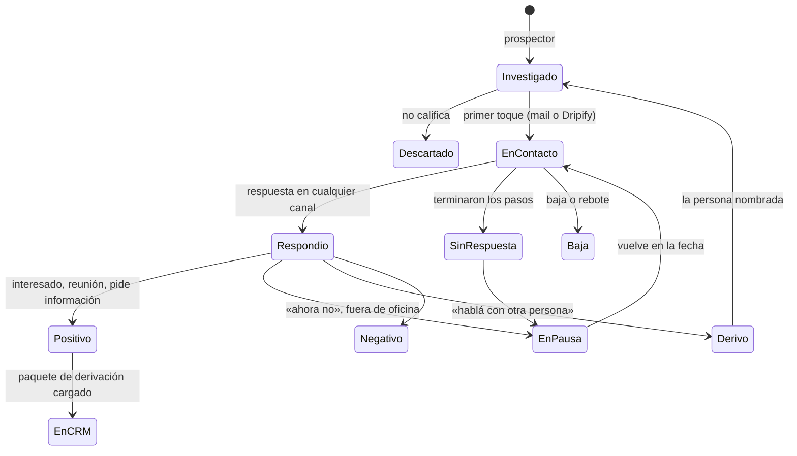

# Datos de la prospección y del CRM

Estado: **diseño**, 04/11/2026. Complementa a `09-arquitectura-v2.md` (Grok Bot orquesta).
Responde tres preguntas: qué datos necesitan los bots para hacer el seguimiento, dónde viven, y
qué se carga en el CRM del cliente, cuándo y con qué campos, en HubSpot y en Dynamics 365.

## 1. Lo que definió Biguá

- Al CRM va **sólo la respuesta positiva**, o lo que se le pida al bot. Un contacto que todavía
  no respondió no se carga.
- HubSpot es el primer CRM; hay un cliente con **Dynamics 365** en carpeta.
- El consentimiento para WhatsApp ya existe cuando se tiene el número: no es un tema del bot.
- Las aprobaciones se hacen en el **chat de Grok, con el líder de los bots** (`orquestador`).

## 2. Dónde vive el seguimiento de quienes no respondieron

Si el CRM sólo recibe positivos, la memoria de los bots para todos los demás tiene que estar en
otro lado. Sin ella no se puede: saber a quién ya se le escribió, cuándo toca el seguimiento,
sacar de Dripify a quien respondió por mail, ni no volver a prospectar la misma cuenta la semana
que viene.

| Opción | A favor | En contra | ¿Sirve? |
|---|---|---|---|
| **Registro de prospección en Supabase** (`sdrbot`), por cliente, servido por el mismo MCP que el gateway y las reglas | Uno solo para todos los clientes, tengan el CRM que tengan; el CRM del cliente queda limpio; se junta con lo que el gateway ya guarda del correo; mismo aislamiento por cliente | Es una pieza más que construir (chica: §3) | **Sí. Recomendado** |
| Sólo el registro del gateway | Ya existe | Sólo ve el correo: no sabe de Dripify ni de WhatsApp ni de las decisiones de los bots | No alcanza |
| Todos los contactos en el CRM desde el primer toque | Todo en un lugar | Contradice la definición de §1; ensucia el CRM del cliente con cientos de contactos que nunca respondieron | No |
| Memorias o archivos de Grok | Nada que construir | No es consultable, no es igual entre clientes, se pierde si se rearma la cuenta, no se puede auditar | No |

**Decisión propuesta:** registro de prospección en Supabase como memoria de trabajo de los
bots; el CRM recibe un **paquete de derivación** cuando hay respuesta positiva o a pedido. Esto
reemplaza la idea de una versión anterior de `09` de usar HubSpot como memoria con propiedades `sdr_` en cada contacto.

## 3. El registro de prospección

### 3.1 Qué guarda

Lo mínimo que un bot necesita para decidir el próximo paso sin preguntarle a nadie:

**Cuenta** (empresa prospectada, por cliente)

| Dato | Para qué |
|---|---|
| Id de ASCI, nombre, dominio, país, vertical, tamaño | Identificarla y no repetirla |
| Señales: tipo, fecha, evidencia (URL), resumen | Por qué se la eligió; la tesis del mensaje |
| Tesis | El ángulo del contacto, para que todos los bots escriban lo mismo |
| Estado: `en_investigacion`, `en_contacto`, `en_pausa` (hasta una fecha), `excluida` (motivo: cliente actual, oportunidad abierta en el CRM, pidió no ser contactada) | Qué se puede hacer con ella |

**Prospecto** (persona en una cuenta)

| Dato | Para qué |
|---|---|
| Id de ASCI o Apollo, nombre, cargo, área, seniority | Identificarla |
| Email y su calidad (verificado o extrapolado) | Canal mail |
| URL de LinkedIn | Carga en Dripify |
| WhatsApp (número) | Canal WhatsApp: si está, se puede usar para seguimiento |
| Por qué se la eligió (rol de compra, puntaje) | Auditar el reveal |
| Estado (§3.2), canales activos, campaña de Dripify y fecha de carga | Qué está pasando |
| **Próximo paso, canal y fecha** | Lo que el `orquestador` mira para armar el día |
| Última interacción (fecha y canal) | No escribir dos veces el mismo día por canales distintos |
| Id del registro en el CRM (cuando se cargó) | No cargarlo dos veces |

**Eventos** (línea de tiempo del prospecto, sólo se agrega)

Un evento por cosa que pasa: toque enviado (canal, paso, referencia del envío en el gateway o en
Dripify), respuesta recibida (canal, texto, clasificación), pedido entre bots (quién, a quién,
qué), aprobación (qué, quién la dio en el chat de Grok, cuándo, texto aprobado), carga en el CRM.
Cada evento guarda el bot y la versión de las reglas con que se hizo.

El detalle del correo (mensajes, hilos, cupos) sigue en el gateway; el evento guarda la
referencia. No se duplica.

### 3.2 Estados del prospecto

### 3.3 Herramientas para los bots

En el mismo MCP que el gateway (`sdrbot.bigua.lat/mcp`), mismo token del cliente:

| Herramienta | Qué hace |
|---|---|
| `registro.buscar` | Por email, URL de LinkedIn, id de ASCI o dominio: ¿ya lo tenemos?, ¿en qué estado? |
| `registro.guardar` | Crea o actualiza cuenta o prospecto |
| `registro.evento` | Agrega un evento a la línea de tiempo |
| `registro.agenda` | Los prospectos con próximo paso hoy, por canal: lo que arma el día del `orquestador` |
| `registro.historia` | La línea de tiempo de un prospecto, para que `seguimiento` decida o para armar el paquete del CRM |

## 4. Qué va al CRM y cuándo

| Situación | ¿Se carga? | Cómo |
|---|---|---|
| Respuesta **positiva**: interesado, pide reunión, pide información, acepta una llamada | **Sí**, automático después de la aprobación de la respuesta en el chat de Grok | Paquete de derivación (§5) |
| **Pedido** de una persona en el chat de Grok («cargá a X como lead») | **Sí** | Paquete de derivación con el estado que tenga |
| Reunión agendada | Sí, si el cliente lo pide | Actualiza lo ya cargado: oportunidad o etapa |
| Contactado sin respuesta, en pausa, negativo, fuera de oficina | No | Queda en el registro |
| «Hablá con otra persona» | No | Se prospecta a la persona nombrada; si responde positivo, entra |
| Baja («no me escriban») | No se crea nada. **Si el contacto ya existía en el CRM**, se marca que no quiere ser contactado | Así el resto del equipo del cliente también lo respeta |

## 5. El paquete de derivación

Lo que se escribe en el CRM. Es igual para todos los CRM; cambia el lugar donde va cada dato.

| Dato | HubSpot | Dynamics 365 (Sales) |
|---|---|---|
| Empresa: nombre, sitio web, país, cantidad de empleados | Empresa (`name`, `domain`, `country`, `numberofemployees`), buscada antes por dominio | En el **Lead**: `companyname`, `websiteurl`, `address1_country`, `numberofemployees` |
| Persona: nombre, apellido, email, cargo, teléfono | Contacto (`firstname`, `lastname`, `email`, `jobtitle`, `mobilephone`), buscado antes por email y asociado a la empresa | En el Lead: `firstname`, `lastname`, `emailaddress1`, `jobtitle`, `mobilephone` |
| URL de LinkedIn | Propiedad propia `sdr_linkedin_url` | En la descripción, o columna propia si el cliente acepta personalizar (§6) |
| Que es un lead del SDR | Etapa del ciclo de vida `lead` y estado de lead `nuevo`; propiedad propia `sdr_origen` = «SDR Bot Biguá». Si el cliente usa el objeto **Lead** de HubSpot, también un Lead | Lead con origen (`leadsourcecode`) = «Otro» y el texto «SDR Bot Biguá» en el asunto (`subject`) |
| Señal y tesis: por qué se lo contactó | Propiedad propia `sdr_senal` + nota | Descripción del Lead + nota |
| La respuesta, textual, con canal y fecha | Nota, y el mail como correo registrado en el contacto | Nota (`annotation`) sobre el Lead |
| Historia resumida: qué se le mandó, por qué canal y cuándo | En la misma nota, en una lista corta | En la misma nota |
| Próximo paso sugerido y urgencia | Tarea al dueño con fecha | Tarea (`task`) sobre el Lead, asignada al dueño |
| Dueño (vendedor) | `hubspot_owner_id` | `ownerid` (usuario o equipo) |
| Referencia al registro de prospección | Propiedad propia `sdr_registro_id` | En la descripción, o columna propia (§6) |

**Por qué Lead en Dynamics 365:** en Dynamics, un lead es justamente un interesado sin
calificar; el equipo del cliente lo califica y ahí Dynamics crea la cuenta, el contacto y la
oportunidad. Es el proceso estándar de ventas y no pisa sus cuentas. Si el cliente prefiere que
entre directo como oportunidad, se cambia por cliente.

**Por qué una sola nota y no cada toque como actividad:** el vendedor necesita entender el caso
en un vistazo; diez actividades de «mail enviado» no ayudan y ensucian la línea de tiempo. Lo
completo está en el registro de prospección, y la nota lo resume.

**Sin duplicados:** antes de cargar, el bot busca en el CRM la empresa (por dominio) y la persona
(por email), y en Dynamics también un lead abierto con ese email. Si existe, agrega la nota y la
tarea sobre lo existente en vez de crear otro.

## 6. Qué se lee del CRM (aunque no se escriba)

Antes de revelar contactos de una cuenta, el `prospector` consulta el CRM:

| Pregunta | HubSpot | Dynamics 365 |
|---|---|---|
| ¿Es cliente? | Empresa con etapa `customer` | Cuenta con relación de tipo cliente o con oportunidades ganadas |
| ¿Hay una oportunidad abierta? | Negocio abierto asociado | Oportunidad abierta |
| ¿Ya hay alguien trabajándola? | Dueño asignado con actividad reciente | Dueño de la cuenta y actividad reciente |
| ¿La persona pidió no ser contactada? | Baja de email o propiedad equivalente | `donotemail`, `donotbulkemail` |

Si alguna da sí, la cuenta queda `excluida` en el registro con el motivo, y no se gasta nada.

## 7. Cómo llega el bot al CRM

| Opción | A favor | En contra |
|---|---|---|
| Conector nativo de cada CRM en Grok | Nada que construir | HubSpot quizá; Dynamics 365 casi seguro no tiene (`10` 3.1) |
| **Herramientas `crm.*` en el MCP de Biguá**, con un adaptador por CRM | **Las reglas de los bots son las mismas para todos los clientes**: el bot llama `crm.cargar_derivacion` sin saber si es HubSpot o Dynamics. Credenciales cifradas como las de buzones | Es código nuestro, uno por CRM |

**Recomendación: `crm.*` en el MCP de Biguá.** Es lo que hace que el harness sea estándar
(punto 7 del modelo, `09` §0): si cada cliente usa un conector distinto, las reglas de cada bot
cambian por cliente. Herramientas:

| Herramienta | Qué hace |
|---|---|
| `crm.exclusiones(dominio)` | Las preguntas de §6 |
| `crm.buscar(email o dominio)` | ¿Existe? ¿Quién es el dueño? |
| `crm.cargar_derivacion(paquete)` | Crea o actualiza según §5 y devuelve el id |
| `crm.marcar_baja(email)` | Sólo si el contacto ya existe (§4) |

### 7.1 Credenciales y permisos

| | HubSpot | Dynamics 365 |
|---|---|---|
| Credencial | Token de una app privada del portal del cliente | Aplicación en el Entra ID del cliente con certificado + **usuario de aplicación** en Dataverse (mismo patrón que Microsoft 365 en `08` §4.1) |
| Permisos | Lectura y escritura de contactos y empresas; lectura de negocios y dueños; notas y tareas (lista exacta al implementar) | Un rol de seguridad propio: crear, leer y escribir Leads; leer cuentas, contactos y oportunidades; crear notas y tareas sobre Leads; leer usuarios |
| Personalización | Cuatro propiedades propias (`sdr_origen`, `sdr_senal`, `sdr_linkedin_url`, `sdr_registro_id`), creadas en el alta | **Ninguna por defecto**: todo entra en campos estándar, descripción y nota. Columnas propias sólo si el cliente lo acepta (pide una solución instalada por su TI) |
| Dónde se carga | Panel `/admin`, cifrada | Panel `/admin`, cifrada |

## 8. Dónde ve el cliente la prospección que no está en el CRM

- **En el chat de Grok**, preguntándole al `orquestador` («¿cómo viene la semana?», «¿qué pasó
  con la cuenta X?»), que responde con el registro.
- **En el panel**, una vista del registro por cliente (embudo y línea de tiempo por prospecto).
- **Resumen diario o semanal** del `orquestador`.

## 9. Retención

Los prospectos que nunca respondieron sólo existen en el registro de Biguá. Se guardan mientras
dure el contrato más el plazo del manifiesto (`02` §10), se borran a pedido de la persona y se
exportan al cliente en la baja.

## 10. Para confirmar

1. **Registro de prospección en Supabase** como memoria de los bots (§2).
2. **«Positivo»** = interesado, pide reunión, pide información o acepta una llamada. ¿Algo más, o
   algo de eso no?
3. **Dynamics 365:** ¿Lead (recomendado) u oportunidad directa? ¿Aceptarían columnas propias?
4. **HubSpot:** ¿usan el objeto Lead o sólo contactos con etapa `lead`? ¿Crear negocio cuando
   hay reunión?
5. **Bajas:** ¿marcar en el CRM a quien ya existía ahí y pidió no ser contactado?
