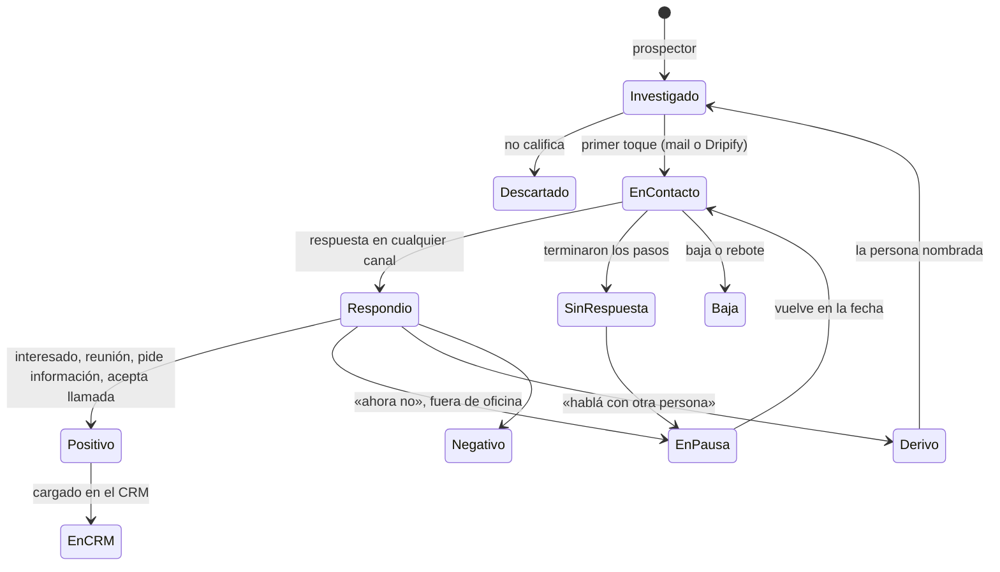

# Datos de la prospección, CRM y dashboard del cliente

Estado: **diseño acordado con Biguá el 04/11/2026** («dejémoslo así inicialmente y lo
corregimos si hace falta»). Complementa a `09-arquitectura-v2.md` (Grok Bot orquesta).

Responde cuatro preguntas: qué datos necesitan los bots para hacer el seguimiento, dónde viven,
qué se carga en el CRM del cliente (cuándo y cómo, en HubSpot y en Dynamics 365) y qué ve el
cliente de lo que hacemos.

## 1. Lo que está decidido

| Tema | Decisión |
|---|---|
| Memoria de los bots | **Registro de prospección en Supabase**, por cliente (§2, §3) |
| Dashboard del cliente | Sale del mismo registro: el cliente ve qué estamos haciendo (§8) |
| Qué va al CRM | Sólo la **respuesta positiva** (interesado, pide reunión, pide información, acepta una llamada) o lo que se le pida al bot (§4) |
| Cómo se carga | **El bot decide** qué campos completar y cómo, mirando los datos que el cliente ya tiene, dentro de límites que pone el MCP de Biguá (§5, §6) |
| Dynamics 365 | **Lead** |
| Bajas | Si la persona ya existía en el CRM, se marca ahí y **se avisa al cliente** (§4) |
| Quién aprueba | **Un operador de Biguá**, en el chat de Grok con el `orquestador`. Más adelante, una capa para interactuar con el bot desde Teams, Slack o mail (`09` §9) |
| Calibración de un cliente nuevo | Los primeros 20 mails con aprobación en el chat; después salen solos |
| WhatsApp | Se usa si hay número; el consentimiento ya está resuelto en el origen del dato |

## 2. Por qué un registro propio

Si el CRM sólo recibe positivos, la memoria de los bots para todos los demás tiene que estar en
otro lado. Sin ella no se puede saber a quién ya se le escribió, cuándo toca el seguimiento,
sacar de Dripify a quien respondió por mail, ni evitar prospectar la misma cuenta dos veces.

| Opción | A favor | En contra | ¿Sirve? |
|---|---|---|---|
| **Registro de prospección en Supabase**, servido por el mismo MCP que el gateway y las reglas | Uno para todos los clientes, tengan el CRM que tengan; el CRM del cliente queda limpio; se junta con lo que el gateway ya guarda del correo; mismo aislamiento por cliente; alimenta el dashboard | Una pieza más que construir (chica: §3) | **Sí. Decidido** |
| Sólo el registro del gateway | Ya existe | Sólo ve el correo: no sabe de Dripify, WhatsApp ni las decisiones de los bots | No alcanza |
| Todos los contactos en el CRM desde el primer toque | Todo en un lugar | Contradice §1; ensucia el CRM con cientos de contactos que nunca respondieron | No |
| Memorias o archivos de Grok | Nada que construir | No es consultable, no es igual entre clientes, se pierde si se rearma la cuenta | No |

## 3. El registro de prospección

### 3.1 Qué guarda

**Cuenta** (empresa prospectada, por cliente)

| Dato | Para qué |
|---|---|
| Id de ASCI, nombre, dominio, país, vertical, tamaño | Identificarla y no repetirla |
| Señales: tipo, fecha, evidencia (URL), resumen | Por qué se la eligió; la tesis del mensaje |
| Tesis | El ángulo del contacto, para que todos los bots escriban lo mismo |
| Estado: `en_investigacion`, `en_contacto`, `en_pausa` (hasta una fecha), `excluida` (motivo: cliente actual, oportunidad abierta en el CRM, pidió no ser contactada) | Qué se puede hacer con ella |

**Prospecto** (persona en una cuenta)

| Dato | Para qué |
|---|---|
| Id de ASCI o Apollo, nombre, cargo, área, seniority | Identificarla |
| Email y su calidad (verificado o extrapolado) | Canal mail |
| URL de LinkedIn | Carga en Dripify |
| Número de WhatsApp | Seguimiento por WhatsApp |
| Por qué se la eligió (rol de compra, puntaje) | Auditar el reveal |
| Estado (§3.2), canales activos, campaña de Dripify y fecha de carga | Qué está pasando |
| **Próximo paso, canal y fecha** | Lo que el `orquestador` mira para armar el día |
| Última interacción (fecha y canal) | No escribir dos veces el mismo día por canales distintos |
| Id del registro en el CRM (cuando se cargó) | No cargarlo dos veces |

**Eventos** (línea de tiempo, sólo se agrega)

Un evento por cosa que pasa, de un tipo de una lista fija (§3.3): toque, respuesta, pedido
entre bots, aprobación, carga en el CRM, aviso al cliente. Cada uno guarda el bot, la versión de
las reglas, la referencia externa (envío del gateway, evento de Dripify, id en el CRM) y si es
**interno** (conversaciones entre bots, decisiones) o **visible para el cliente**.

El detalle del correo (mensajes, hilos, cupos) sigue en el gateway; el evento guarda la
referencia.

### 3.2 Estados del prospecto

### 3.3 Tipos de evento

Una lista fija, porque el dashboard cuenta eventos: si cada bot los nombra a su manera, los
números no cierran.

| Tipo | Quién lo escribe | Visible para el cliente |
|---|---|---|
| `cuenta.investigada`, `cuenta.excluida` | `prospector` | Sí (la exclusión, con su motivo) |
| `prospecto.revelado` | `prospector` | Sí |
| `mail.enviado`, `mail.rebotado` | Gateway | Sí |
| `linkedin.cargado` (en una campaña de Dripify) | `linkedin` | Sí |
| `linkedin.invitacion`, `linkedin.conexion`, `linkedin.mensaje` | Gateway, por webhook de Dripify | Sí |
| `whatsapp.enviado` | `whatsapp` | Sí |
| `respuesta` (canal, clasificación) | Gateway o el bot del canal + `seguimiento` | Sí |
| `positivo`, `crm.cargado`, `baja` | `seguimiento` | Sí |
| `aprobacion` | `orquestador` | Sí |
| `pedido` (entre bots), `decision` | Cada bot | **No** (interno) |
| `aviso.cliente` | `seguimiento` u `orquestador` | Sí: es lo que se le notifica |

Qué eventos manda Dripify por webhook (invitación enviada, aceptada, respuesta) hay que
confirmarlo en su configuración; los que no mande los registra `linkedin` al leer la campaña.

### 3.4 Herramientas para los bots

En el mismo MCP que el gateway (`sdrbot.bigua.lat/mcp`), mismo token del cliente:

| Herramienta | Qué hace |
|---|---|
| `registro.buscar` | Por email, URL de LinkedIn, id de ASCI o dominio: ¿ya lo tenemos?, ¿en qué estado? |
| `registro.guardar` | Crea o actualiza cuenta o prospecto |
| `registro.evento` | Agrega un evento (de los tipos de §3.3) |
| `registro.agenda` | Los prospectos con próximo paso hoy, por canal: el día del `orquestador` |
| `registro.historia` | La línea de tiempo de un prospecto |

## 4. Qué va al CRM y cuándo

| Situación | ¿Se carga? | Cómo |
|---|---|---|
| Respuesta **positiva** | **Sí**, después de que el operador de Biguá aprueba la respuesta en el chat de Grok | §5 |
| **Pedido** en el chat de Grok («cargá a X como lead») | **Sí** | §5, con el estado que tenga |
| Reunión agendada | Sí, si el cliente lo quiere | Actualiza lo ya cargado |
| Contactado sin respuesta, en pausa, negativo, fuera de oficina | No | Queda en el registro y en el dashboard |
| «Hablá con otra persona» | No | Se prospecta a la persona nombrada |
| **Baja** («no me escriban») | No se crea nada. **Si la persona ya existía en el CRM**, se marca que no quiere ser contactada **y se avisa al cliente** | Evento `aviso.cliente`: aparece en el dashboard y en el resumen (§8.3) |

## 5. Cómo se carga: el bot decide, con un mínimo obligatorio

Como pidió Biguá, el bot no completa un formulario fijo: mira cómo tiene armado el CRM el
cliente (qué campos existen, cuáles usa, qué listas de valores tiene) y decide qué completar y
cómo contar la historia. Pero siempre deja un mínimo, para que cualquier carga sea útil y se
pueda auditar.

### 5.1 El mínimo obligatorio

| Dato | HubSpot | Dynamics 365 |
|---|---|---|
| Quién es: nombre, apellido, email, cargo | Contacto, buscado antes por email | **Lead**: `firstname`, `lastname`, `emailaddress1`, `jobtitle` |
| De qué empresa | Empresa por dominio, asociada | En el Lead: `companyname`, `websiteurl` |
| Que vino del SDR | Una propiedad que lo diga (la del cliente si tiene una de origen; si no, `sdr_origen`) | Origen del lead + «SDR Bot Biguá» en el asunto (`subject`) |
| La respuesta textual, con canal y fecha | Nota y correo registrado | Nota sobre el Lead |
| Próximo paso y para quién | Tarea al dueño con fecha | Tarea sobre el Lead, asignada al dueño |
| Dueño | `hubspot_owner_id` | `ownerid` |
| Referencia al registro de prospección | En la nota | En la nota |

### 5.2 Lo que decide el bot

- **Qué campos del cliente completar:** industria, tamaño, país, producto de interés, campaña,
  lo que el cliente tenga y el bot pueda llenar con lo que sabe (de ASCI, de Apollo, de la
  conversación). Usa los valores de las listas que ya existen; no inventa valores nuevos.
- **Cómo contar la historia:** la conversación como actividades en la línea de tiempo (cada mail
  del hilo como correo, LinkedIn y WhatsApp como notas o actividades), o una nota con el resumen,
  según lo que use ese cliente.
- **Qué dejar al vendedor:** la tarea, con el contexto que haga falta para responder bien.

### 5.3 El mapeo se aprende y se aprueba una vez

La primera carga de cada cliente, el bot describe en el chat de Grok cómo piensa cargar (qué
campos, qué valores, dónde la conversación) y el operador de Biguá lo aprueba o lo corrige. Ese
mapeo queda guardado en los ajustes del cliente (`09` §3) y las cargas siguientes lo siguen. Así
el bot tiene libertad, pero dos cargas del mismo cliente no salen distintas. Si el cliente cambia
su CRM (un campo nuevo, una lista distinta), el bot propone actualizar el mapeo en el chat.

Las primeras cargas en el CRM de un cliente, igual que los primeros mails, se aprueban en el
chat antes de escribir (calibración).

## 6. Cómo llega el bot al CRM: por MCP, con límites

### 6.1 Herramientas `crm.*`

En el MCP de Biguá, con un adaptador por CRM (HubSpot, Dynamics 365). No son un formulario fijo:
le dan al bot la forma de explorar y escribir el CRM del cliente, y del otro lado ponen los
límites.

| Herramienta | Qué hace |
|---|---|
| `crm.describir(entidad)` | Los campos de esa entidad en el CRM del cliente: nombre, tipo, valores posibles, si es obligatorio, y la nota del mapeo aprobado (§5.3) |
| `crm.buscar(entidad, criterios)` | Buscar por email, dominio, nombre |
| `crm.exclusiones(dominio)` | ¿Es cliente? ¿Oportunidad abierta? ¿Alguien la trabaja? ¿La persona pidió no ser contactada? |
| `crm.crear(entidad, campos)` / `crm.actualizar(entidad, id, campos)` | Escribir, dentro de los límites de §6.2 |
| `crm.nota`, `crm.actividad`, `crm.tarea` | La línea de tiempo y el próximo paso |
| `crm.marcar_baja(email)` | Sólo si la persona ya existe (§4) |

### 6.2 Los límites (reglas duras)

| Límite | Por qué |
|---|---|
| Sólo las entidades permitidas para ese cliente. Por defecto: crear y actualizar Lead (Dynamics) o contacto y empresa (HubSpot); crear notas, actividades y tareas; leer el resto | Que un bot no toque oportunidades, cuentas de clientes o configuración |
| **Nunca borra** | Igual que en el correo |
| **No pisa datos que el cliente ya cargó**: en un registro existente sólo completa campos vacíos; cambiar uno lleno pide aprobación en el chat | El CRM es del cliente |
| No cambia dueño ni estado de registros que no creó el bot | Ídem |
| Valida contra el esquema: tipo, valores de las listas, obligatorios | Que no falle a medias ni invente valores |
| Antes de crear, busca duplicados (por email y dominio; en Dynamics también un Lead abierto con ese email) | Un solo registro por persona |
| Cada escritura queda en el registro de prospección con lo que había antes y lo que quedó | Auditoría y forma de deshacer a mano |
| Tope de escrituras por día | Un bot en bucle no llena el CRM |

### 6.3 Por qué por el MCP de Biguá y no un conector directo

| Opción | A favor | En contra |
|---|---|---|
| Conector nativo o MCP oficial de cada CRM en Grok | Nada que construir; acceso completo | Con acceso completo el bot puede borrar o pisar datos del cliente; las reglas de los bots cambian por cliente; Dynamics 365 no tiene un MCP remoto que Grok pueda conectar con cabecera fija **(verificar)** |
| **`crm.*` en el MCP de Biguá** | Los límites de §6.2 son duros; las reglas de los bots son las mismas con cualquier CRM; auditoría en el registro; credenciales cifradas como las de buzones | Código nuestro, un adaptador por CRM |

En Dynamics 365 hay además una baranda del lado del cliente: el usuario de aplicación tiene un
rol de seguridad que sólo permite lo de §6.2. Aunque nuestro código fallara, Dynamics no deja
hacer más.

### 6.4 Credenciales y permisos

| | HubSpot | Dynamics 365 |
|---|---|---|
| Credencial | Token de una app privada del portal del cliente | Aplicación en el Entra ID del cliente con certificado + **usuario de aplicación** en Dataverse (mismo patrón que Microsoft 365, `08` §4.1) |
| Permisos | Lectura y escritura de contactos y empresas; lectura de negocios, dueños y el esquema de propiedades; notas, correos registrados y tareas (lista exacta al implementar) | Rol de seguridad propio: crear, leer y escribir Leads; leer cuentas, contactos, oportunidades, usuarios y metadatos; crear notas y actividades sobre Leads |
| Personalización | Ninguna obligatoria; `sdr_origen` sólo si el cliente no tiene una propiedad de origen | Ninguna |
| Dónde se carga | Panel `/admin`, cifrada | Panel `/admin`, cifrada |

## 7. Qué se lee del CRM antes de prospectar

Antes de revelar contactos de una cuenta, el `prospector` llama `crm.exclusiones`:

| Pregunta | HubSpot | Dynamics 365 |
|---|---|---|
| ¿Es cliente? | Empresa con etapa `customer` | Cuenta de tipo cliente o con oportunidades ganadas |
| ¿Hay una oportunidad abierta? | Negocio abierto asociado | Oportunidad abierta |
| ¿Ya hay alguien trabajándola? | Dueño con actividad reciente | Dueño de la cuenta con actividad reciente |
| ¿La persona pidió no ser contactada? | Baja de email | `donotemail`, `donotbulkemail` |

Si alguna da sí, la cuenta queda `excluida` con el motivo y no se gasta nada.

## 8. El dashboard del cliente

El registro de prospección es también lo que el cliente ve de nuestro trabajo.

### 8.1 Dónde

En el panel que ya existe (`sdrbot.bigua.lat/admin`), con los usuarios del cliente que ya tienen
rol (`client_admin`) y un rol nuevo de sólo lectura para quien sólo mira. Mismo aislamiento por
cliente que los buzones: un cliente no ve nada de otro.

### 8.2 Qué muestra

| Bloque | Qué |
|---|---|
| **Números de la semana y del mes** | Cuentas investigadas · personas contactadas · mails enviados · invitaciones de LinkedIn enviadas y aceptadas · mensajes de LinkedIn · WhatsApp enviados · respuestas (y tasa) · positivos · cargados en el CRM |
| **Embudo** | Investigadas → contactadas → respondieron → positivas → en el CRM |
| **Por canal** | Mail, LinkedIn y WhatsApp lado a lado: enviados, respuestas, positivos |
| **Por señal y por segmento** | Qué tipo de señal y qué campaña de Dripify traen más respuestas |
| **Positivos** | Lista con la respuesta, la fecha y el enlace al registro en su CRM |
| **Línea de tiempo por cuenta** | Los eventos visibles (§3.3): qué se le mandó a quién, cuándo y qué contestó |
| **Avisos** | Bajas de personas que estaban en su CRM, cuentas excluidas por estar en su CRM, y lo que haga falta avisar |
| **Salud** | Estado de los buzones y del dominio (lo que ya muestra el panel), sesiones de LinkedIn y WhatsApp |

No se muestran las conversaciones entre bots ni sus decisiones internas: eso es para Biguá.

### 8.3 Avisos al cliente

Mientras no exista la capa de integración (Teams, Slack, mail; `09` §9), los avisos quedan
guardados como eventos `aviso.cliente`, se muestran en el dashboard con un contador de no leídos
y van en un resumen semanal por mail que manda el `orquestador` por el gateway desde un buzón de
Biguá.

## 9. Retención

Los prospectos que nunca respondieron sólo existen en el registro de Biguá. Se guardan mientras
dure el contrato más el plazo del manifiesto (`02` §10), se borran a pedido de la persona y se
exportan al cliente en la baja.

## 10. Abierto

- Qué eventos manda el webhook de Dripify (§3.3): se confirma al configurarlo.
- Si a un cliente le interesa que la reunión agendada actualice el CRM (§4).
- La capa de integración con Teams, Slack o mail para aprobar y avisar (`09` §9).
