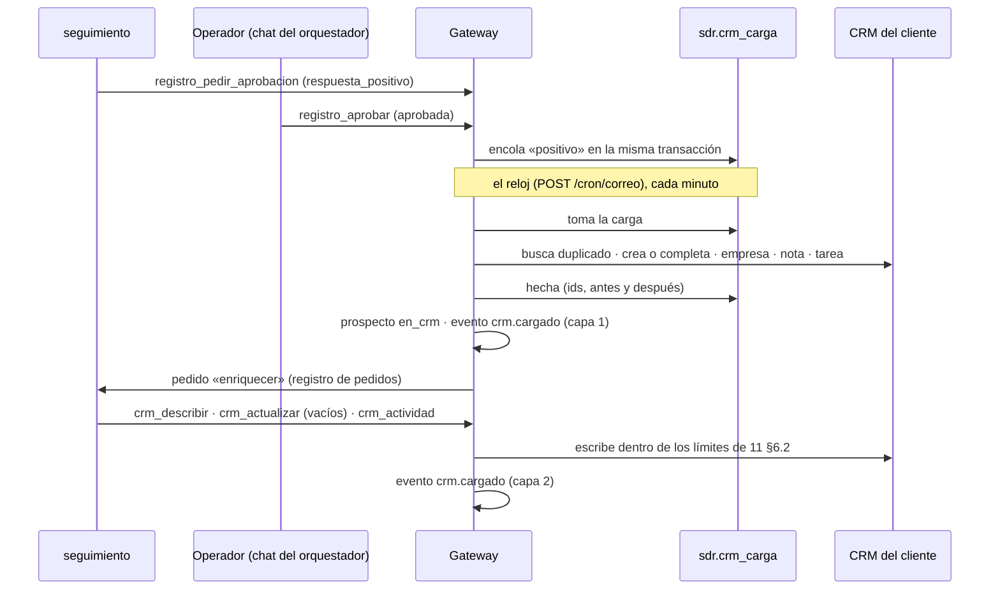

# Carga en el CRM: variante mixta

Estado: **decidido el 09/11/2026; etapa 4a (capa 1 con HubSpot) construida** en el gateway
(migración `013_crm`, `src/sdr/crm.mjs`, `test/crm.test.mjs`). Revisa la carga en el CRM de
`11-datos-crm-y-seguimiento.md` (§5 y §6). Lo que está construido y cómo se usa está en §13. Lo que no se toca de `11` sigue igual: qué va al CRM (sólo lo positivo, lo que se le
pida al bot y las bajas de personas que ya estaban), las exclusiones antes de prospectar (§7), las
credenciales (§6.4) y el dashboard (§8).

## 1. El problema

En `11` §5 el bot hace toda la carga: busca duplicados, crea el contacto o el Lead, asocia la
empresa, deja la nota y la tarea, y decide qué otros campos llenar. El MCP pone los límites, pero
**si el bot no llama, la carga no ocurre**.

| Falla | Qué pasa hoy | Costo |
|---|---|---|
| El bot no carga: se le corta la corrida, se olvida, la revisión automática lo frena | El positivo queda sólo en el registro | El peor error del servicio: un interesado que el vendedor no ve |
| Falla a medias (creó el contacto, no la tarea) | Nadie sabe que falta algo | El vendedor no se entera de que tiene que responder |
| Dos cargas del mismo cliente salen distintas | El mapeo aprobado lo limita, pero lo interpreta el modelo | Datos desparejos en el CRM del cliente |
| El CRM no responde | El bot reintenta o no, según la corrida | Sin reintentos ni alerta garantizados |

Lo que necesita criterio (qué campos del cliente completar y cómo contar la conversación) es una
parte chica de la carga. Lo que no puede fallar (que el positivo llegue con lo mínimo para
responderle) no necesita criterio.

## 2. La propuesta

Partir la carga en dos capas.

| | Capa 1 · mínimo garantizado | Capa 2 · enriquecimiento |
|---|---|---|
| Quién | **El gateway**, por código | **El bot `seguimiento`**, por `crm.*` |
| Cuándo | Al aprobarse la respuesta a un positivo, al pedirse una carga o al detectarse una baja (§3.1) | Después de la capa 1, cuando el gateway se lo pide |
| Qué escribe | El mínimo de `11` §5.1: persona, empresa, origen, respuesta textual, tarea al dueño, referencia al registro | Lo que suma: campos del cliente que estén vacíos, la conversación como actividades, contexto en la tarea |
| Mapeo | Fijo por CRM (§4), con dos datos que se eligen en el panel | El mapeo aprobado de `11` §5.3, que ahora sólo cubre lo opcional |
| Si falla | Reintenta, alerta y queda visible en el panel (§6) | No pasa nada grave: el positivo ya está en el CRM |
| Crea registros | Sí, es el único que crea | **No.** Sólo completa campos vacíos y agrega notas, actividades y tareas |

## 3. Capa 1: el mínimo, por código

### 3.1 Qué la dispara

| Disparador | Motivo de la carga | Por qué ahí |
|---|---|---|
| `registro_aprobar` con `aprobada` sobre una aprobación `respuesta_positivo` | `positivo` | Es el momento en que un humano confirma que es un positivo. No depende de que la respuesta salga: si el envío falla, el interesado igual existe |
| Herramienta nueva `crm_cargar(prospecto_id, motivo)`, para el `orquestador` | `pedido` | «Cargá a X como lead» en el chat (`11` §4). Reemplaza al `crm.crear` del bot |
| Botón **Cargar en el CRM** en la lista de positivos del panel | `pedido` | Para el operador o el cliente, sin pasar por el bot |
| El gateway registra una `baja` (ya la detecta desde la etapa 2) | `baja` | Si la persona existía en el CRM, se marca ahí y se avisa (`11` §4). Es una búsqueda y un cambio de un campo: no necesita bot |

Encolar es una fila en `sdr.crm_carga` dentro de la misma transacción que la aprobación o la baja.
Si la aprobación se guarda, la carga existe; no hay forma de aprobar y que se pierda.

Una aprobación **rechazada** no encola nada: si el operador no aprueba la respuesta, el positivo no
está confirmado. Si igual quiere cargarlo, usa el botón o se lo pide al `orquestador`.

### 3.2 Qué hace

En este orden, cada paso idempotente (si se reintenta, no duplica):

1. **Chequea la conexión** del cliente (§5): si está pausada o con la credencial vencida, la carga
   espera sin gastar intentos.
2. **Busca duplicados.** HubSpot: contacto por email. Dynamics: Lead abierto con ese email, y
   después contacto con ese email.
3. **Crea o completa.** Si no existe, lo crea con el mínimo. Si existe, sólo completa campos vacíos
   (regla de `11` §6.2) y **no cambia el dueño**.
4. **Empresa** (sólo HubSpot): busca por dominio, la crea si no está y la asocia. En Dynamics van
   `companyname` y `websiteurl` en el Lead.
5. **Nota** con la respuesta textual, el canal, la fecha y la referencia al registro.
6. **Tarea** para el dueño: el del registro existente si había uno, si no el dueño por defecto
   (§5). Vence el día hábil siguiente.
7. **Cierra:** guarda los ids y el antes y después en `sdr.crm_carga`; pone `crm_id` en el
   prospecto y lo pasa a `en_crm`; agrega el evento `crm.cargado` con `capa: 1`, visible para el
   cliente; y deja un pedido a `seguimiento` para la capa 2.

Para una `baja` son sólo los pasos 1 y 2. Si la persona existe, se marca que no quiere ser
contactada y se agrega el evento `aviso.cliente`. Si no existe, no se crea nada.

### 3.3 Dónde corre

En la vuelta del reloj que ya existe (`POST /cron/correo`, pg_cron cada minuto), antes de leer los
buzones y con hasta 15 segundos: así no hace falta otro job de pg_cron, y un positivo no espera a
que se lean todos los buzones. Cada vuelta toma hasta 20 cargas, de a una, con `for update skip
locked`: dos vueltas superpuestas no toman la misma. Una carga que quedó tomada más de 10 minutos
(la función se cortó) se vuelve a tomar.

## 4. El mapeo del mínimo

Fijo en el código, uno por CRM. Es la tabla de `11` §5.1, ahora como contrato:

| Dato | HubSpot | Dynamics 365 (Lead) |
|---|---|---|
| Nombre, apellido | `firstname`, `lastname` | `firstname`, `lastname` |
| Email | `email` (clave de búsqueda) | `emailaddress1` (clave de búsqueda) |
| Cargo | `jobtitle` | `jobtitle` |
| Empresa | Empresa por `domain`, asociada | `companyname`, `websiteurl` |
| Origen | La propiedad elegida en el panel, con el valor elegido (§5) | `leadsourcecode` con el valor elegido + «SDR Bot Biguá» en `subject` |
| Respuesta textual, canal y fecha | Nota asociada al contacto y la empresa | Nota (`annotation`) sobre el Lead |
| Próximo paso | Tarea asociada, al dueño | Tarea sobre el Lead, al dueño |
| Dueño | `hubspot_owner_id` | `ownerid` |
| Referencia al registro | En la nota: id del prospecto y enlace al panel | En la nota |

El texto de la nota y de la tarea sale de una plantilla del código, con el nombre del cliente y la
campaña. No lo redacta un modelo.

## 5. Lo que se configura en el panel

En **Canales → CRM** (`21` §3), por cliente:

| Ajuste | Qué | Quién |
|---|---|---|
| Conexión | HubSpot: token de la app privada. Dynamics: id de la aplicación, tenant, certificado y URL del entorno. Se guarda cifrada con la misma clave que los buzones | Cliente o Biguá |
| Probar conexión | Lee el esquema y los dueños, y verifica que los permisos alcancen (`11` §6.4) | Cualquiera |
| Propiedad y valor de origen | Elegir de las propiedades que el cliente ya tiene (con su lista de valores). Vacía: el origen va sólo en la nota (el gateway no crea propiedades en el portal del cliente) | Cliente o Biguá |
| Dueño por defecto | De la lista de dueños del CRM | Cliente |
| Campos obligatorios propios | Si el CRM del cliente exige un campo que no está en el mínimo, se le pone un valor fijo acá (§6) | Biguá |
| Vista previa | Toma un positivo real (o uno de ejemplo) y muestra exactamente qué se escribiría, sin escribir | Cualquiera |
| Pausar | Frena las cargas sin perderlas: quedan encoladas | Cliente o Biguá |
| Tope por día | Por defecto 50 cargas | Biguá |

La vista previa reemplaza a la «carga de prueba»: una prueba real dejaría un registro en el CRM del
cliente, y no borramos nada.

Debajo, en la misma sección, las **cargas** con su estado: *cargado* (con enlace al contacto), *en
cola*, *falló* o *bloqueada* (con el motivo y el botón *Reintentar*), y los **positivos sin cargar**
(por ejemplo, de antes de conectar el CRM) con el botón *Cargar en el CRM*. El **Resumen** suma el
canal CRM y avisa si el token fue rechazado o si hay cargas con problemas.

## 6. Cuando algo falla

| Caso | Qué hace el gateway | Qué ve la gente |
|---|---|---|
| El CRM responde con error 5xx o 429, o no responde | Reintenta con espera creciente: 1 min, 5 min, 30 min, 2 h, 6 h y 12 h | *Reintentando* en el panel. Después del último intento pasa a *error*, se avisa al `orquestador` (que lo dice en su chat) y queda una alerta en Salud |
| La credencial está vencida o revocada (401/403) | Pausa la conexión del cliente; las cargas quedan en cola sin gastar intentos | Salud en rojo y un aviso al cliente para reconectar. Al reconectar, la cola sigue sola |
| El CRM exige un campo que no está en el mínimo | La carga queda *bloqueada* con el nombre del campo | Biguá le pone un valor en el panel (§5) y la reintenta |
| Un valor no está en la lista del CRM (por ejemplo, el valor de origen se borró) | *Bloqueada*, con el valor que falta | Ídem |
| Existe un registro con dueño distinto | No cambia el dueño. La tarea va al dueño existente | Normal |
| Hay varios duplicados por email | Usa el más reciente y lo dice en la nota | Normal; la auditoría lo muestra |
| Se llegó al tope del día | La carga espera al día siguiente | *En cola* |

Un positivo nunca queda en silencio: o está cargado, o está en una cola que se ve en el panel, en
la agenda del `orquestador` y en el resumen.

## 7. Capa 2: el enriquecimiento, por el bot

Al cerrar la capa 1, el gateway deja un pedido para `seguimiento` (el mismo mecanismo de
`registro_pedir`, `09` §4.3) con el `crm_id` y la carga hecha. El bot:

1. Lee el esquema del cliente con `crm_describir` y el mapeo aprobado.
2. Completa los campos **vacíos** que pueda llenar con lo que sabe (industria, tamaño, país,
   producto de interés, campaña), usando los valores de las listas existentes.
3. Agrega la conversación como actividades o como una nota de resumen, según lo que use el cliente.
4. Si suma contexto para el vendedor, lo agrega a la tarea existente (no crea otra).

Cambia respecto de `11`:

- **El bot no crea registros ni cambia nada de lo que escribió la capa 1.** Las herramientas
  `crm.crear` y `crm.marcar_baja` dejan de estar expuestas a los bots. Quedan `crm_describir`,
  `crm_buscar`, `crm_exclusiones`, `crm_actualizar` (sólo campos vacíos), `crm_nota`,
  `crm_actividad`, `crm_tarea` y `crm_cargar` (que sólo encola).
- **El mapeo aprobado (`crm_mapeo`) cubre sólo lo opcional.** La primera vez el bot lo propone en
  el chat del `orquestador`, como ya está previsto. Mientras no esté aprobado, la capa 2 no escribe;
  la capa 1 no lo necesita.
- **La calibración de las primeras cargas** (`11` §5.3) queda sólo para la capa 2. La capa 1 se
  calibra en el alta, con la vista previa del panel.
- **Si la capa 2 no corre, no pasa nada grave**: el pedido queda pendiente y se ve en
  `registro_pendientes`.

Todas las escrituras de la capa 2 siguen con los límites de `11` §6.2 y la auditoría.

## 8. Modelo de datos

Una migración nueva (`013_crm.sql`), en el esquema `sdr`, con RLS por `client_id` como las demás.

**`sdr.crm_conexion`** (una por cliente)

| Columna | Qué |
|---|---|
| `client_id` | Clave |
| `proveedor` | `hubspot` o `dynamics` |
| `credencial` | Cifrada, como las contraseñas de los buzones |
| `entorno_url` | Sólo Dynamics |
| `origen_campo`, `origen_valor` | §5 |
| `dueno_defecto` | Id del dueño en el CRM |
| `campos_fijos` | jsonb: campos obligatorios propios con su valor |
| `estado` | `activa`, `pausada`, `credencial_vencida` |
| `tope_dia`, `ultimo_chequeo`, `ultimo_error` | Operación |

**`sdr.crm_carga`** (la cola y su auditoría)

| Columna | Qué |
|---|---|
| `id`, `client_id`, `prospecto_id` | |
| `motivo` | `positivo`, `pedido`, `baja` |
| `aprobacion_id` | La que la disparó, si hubo |
| `estado` | `pendiente`, `en_curso`, `hecha`, `error`, `bloqueada` |
| `intentos`, `proximo_intento` | Reintentos (§6) |
| `crm_ids` | jsonb: contacto o Lead, empresa, nota, tarea |
| `cambios` | jsonb: por registro, lo que había antes y lo que quedó |
| `error` | Último error, legible |
| `pedida_por`, `creado_at`, `hecha_at` | |

Restricción única en `(client_id, prospecto_id)`: un mismo positivo no se encola dos veces aunque se
apruebe y además se apriete el botón. Una carga en `error` o `bloqueada` se reintenta sobre la misma
fila.

Los eventos `crm.cargado` llevan `datos.capa` (1 o 2) y el id de la carga.

## 9. Por qué así

| | Todo el bot (`11` hoy) | Todo por código | **Mixta** |
|---|---|---|---|
| El positivo llega siempre | Depende de la corrida | Sí | **Sí** |
| Se adapta al CRM de cada cliente | Sí | No: mapeo fijo | **Sí, en lo opcional** |
| Reintentos y alertas | A criterio del bot | Sí | **Sí** |
| Cargas parejas en un mismo cliente | Mapeo aprobado, interpretado | Sí | **Sí en lo mínimo; mapeo aprobado en lo demás** |
| Lo que puede romper un bot en el CRM | Crear, actualizar | Nada | **Sólo completar vacíos y agregar notas** |
| Código nuestro | Adaptador por CRM | Adaptador + cola + panel | **Adaptador + cola + panel** (la cola y el panel hacían falta igual para el dashboard) |
| Dependencia de Grok para lo crítico | Total | Ninguna | **Ninguna** |

El costo extra frente a `11` es la cola y su worker. El adaptador por CRM ya estaba previsto, y la
capa 1 usa las mismas funciones que exponen las herramientas `crm_*`.

## 10. Etapas

Reemplaza las etapas 4 (HubSpot) y 6 (Dynamics) de `09` §9.

| Etapa | Qué | Cómo se sabe que está |
|---|---|---|
| **4a** · Capa 1 con HubSpot · **construida** | Migración, adaptador de HubSpot, la cola en la vuelta del reloj, disparo desde `registro_aprobar`, `crm_cargar` y `crm_cargas`, la sección CRM de Canales con la vista previa, las cargas y los positivos sin cargar | Se aprueba un positivo en el chat y, sin que ningún bot haga nada más, aparece en HubSpot con nota y tarea. Con el token revocado, queda en cola y se carga solo al reconectar |
| **4b** · Capa 2 | Pedido de enriquecimiento a `seguimiento`, herramientas `crm_*` acotadas, `crm_mapeo` | La primera carga de un cliente propone el mapeo en el chat; aprobado, las siguientes completan los campos del cliente sin tocar los de la capa 1 |
| **4c** · Bajas | Disparo desde la supresión del gateway | La baja de una persona que estaba en HubSpot la marca ahí y aparece como aviso en el dashboard |
| **6** · Dynamics 365 | Adaptador con usuario de aplicación y rol acotado (`11` §6.3) | Un positivo aprobado de un cliente de D365 aparece como Lead con nota y tarea |

Pruebas (`npm test`): el adaptador va contra un CRM simulado. Cubren la creación, el duplicado con
otro dueño, completar sólo campos vacíos, la credencial vencida, el campo obligatorio propio, los
reintentos, la idempotencia de cada paso y el aislamiento por cliente de las dos tablas nuevas.

## 11. Cambios a otros documentos

- `11` §5: el mínimo pasa a la capa 1. §5.3 aplica sólo a la capa 2. §6.1 queda con la lista de
  herramientas de §7 de este documento.
- `09`: en la tabla de bots, `seguimiento` ya no «carga el positivo en el CRM» sino que lo
  enriquece; el `orquestador` carga a pedido con `crm_cargar`. En el recorrido, `crm.crear` se
  cambia por el encolado al aprobar.
- `21` §3: la tarjeta CRM de Canales con los ajustes de §5.

## 12. Abierto

- ~~¿Disparar al aprobar o al enviar la respuesta?~~ **Al aprobar** (decidido el 09/11/2026).
- **Clientes sin CRM** (Excel o Google Sheets): la misma cola admite un adaptador de planilla que
  sólo agrega filas. No entra en estas etapas.
- Si la reunión agendada actualiza el CRM (`11` §10): sería un motivo más de la capa 1.
- Los scopes exactos de la app privada de HubSpot y el rol de Dynamics se cierran al implementar
  (`11` §6.4).

## 13. Lo construido en la etapa 4a

Diferencias con lo de arriba, decididas al construir:

- **Una carga por prospecto** (`unique (client_id, prospecto_id)`), sea del motivo que sea: un
  pedido sobre alguien ya cargado devuelve «ya está cargado»; sobre una carga con error o
  bloqueada, la vuelve a la cola. Los motivos son `positivo` y `pedido`; `baja` llega con la 4c.
- **Sin email no se carga:** la carga se bloquea con el motivo, sin tocar HubSpot (el email es lo
  que evita duplicados). Un prospecto con baja tampoco.
- **Reintentos:** 7 intentos, con esperas de 1 min, 5 min, 30 min, 2 h, 6 h y 12 h; después,
  `error`. Al pasar a `error` o `bloqueada`, el gateway le deja un pedido al `orquestador` para que
  se lo cuente al operador.
- **Tope por día:** cuenta las cargas hechas en las últimas 24 horas; lo que pasa del tope espera una
  hora sin gastar intentos.
- **Si el buscador de HubSpot todavía no ve un contacto recién creado**, el alta responde 409 con el
  id existente y se usa ese.
- **El enriquecimiento (capa 2) todavía no existe:** al terminar, el gateway no le deja pedido a
  `seguimiento`. Llega con la 4b.

### 13.1 Herramientas y rutas

| Dónde | Qué |
|---|---|
| `registro_aprobar` | Una `respuesta_positivo` aprobada encola la carga en la misma transacción y devuelve `crm: { carga, estado }` |
| `crm_cargar(prospecto_id)` | Para el `orquestador`, cuando el operador pide cargar a alguien |
| `crm_cargas(estado?)` | Cargas recientes, con el enlace al contacto, y los positivos sin carga |
| `GET/PUT /admin/api/clients/:c/crm` | Ver y guardar la conexión (el cliente y Biguá; campos fijos y tope, sólo Biguá) |
| `POST …/crm/probar`, `…/crm/vista-previa` | Probar el token y los permisos (devuelve dueños y propiedades); ver qué se escribiría, sin escribir |
| `POST …/crm/cargar`, `…/crm/cargas/:id/reintentar` | Cargar a mano un positivo sin carga; reintentar una con error o bloqueada |

### 13.2 La app privada de HubSpot

En el portal del cliente: Settings → Integrations → Private Apps → Create a private app, con estos
scopes:

| Scope | Para qué |
|---|---|
| `crm.objects.contacts.read` y `.write` | Buscar, crear y completar el contacto; las notas y las tareas asociadas |
| `crm.objects.companies.read` y `.write` | Buscar la empresa por dominio, crearla y asociarla |
| `crm.objects.owners.read` | Elegir el dueño por defecto |
| `crm.schemas.contacts.read` | Ofrecer las propiedades de origen y validar los valores |

«Probar conexión» verifica las lecturas. Los permisos de escritura se confirman con la primera
carga: si falta uno, la conexión queda en «token rechazado» con el scope que falta, y la carga
espera en la cola hasta que se corrija.
